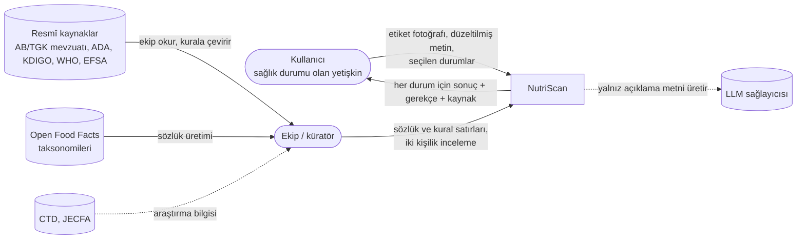
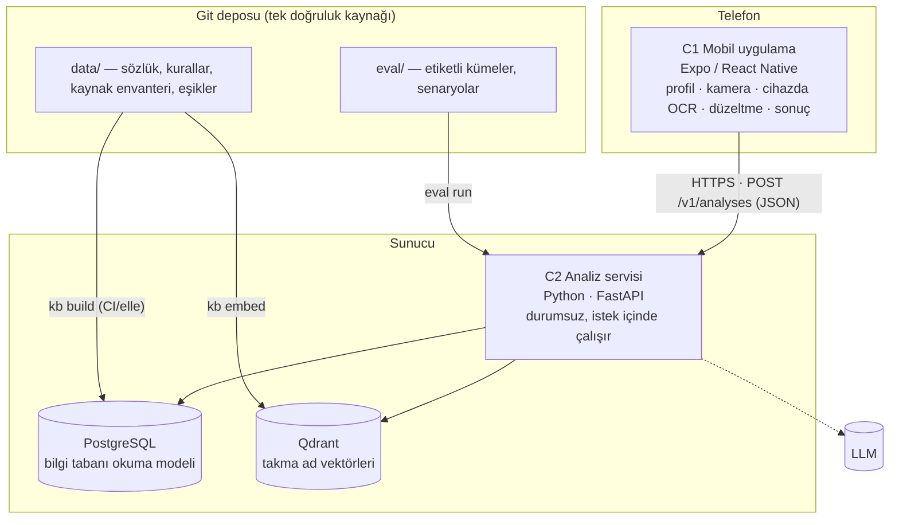
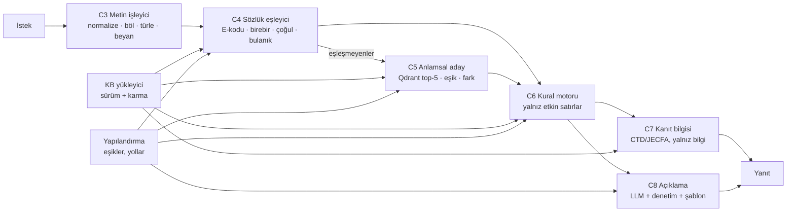
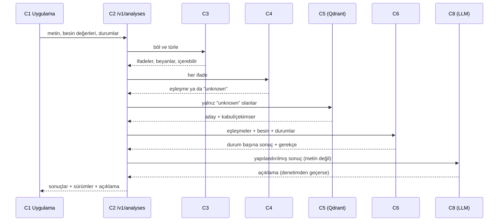

# 02 · Mimari (C4 modeli)

> **Durum:** ÖNERİ (18 Kasım 2026). K1, K5, K7, K10, K11, K13'ü uygulamaya çevirir. Diyagramlar Mermaid ile yazıldı,
> GitHub'da doğrudan çizilir.
>
> **C4 modeli nedir?** Mimariyi dört yakınlaştırma düzeyinde anlatan yaygın bir gösterim (Simon Brown). Düzey 1
> *bağlam*: sistem ve çevresi. Düzey 2 *konteyner*: ayrı çalışan parçalar (uygulama, servis, veritabanı). Düzey 3
> *bileşen*: bir konteynerin içindeki modüller. Düzey 4 koddur, burada yazılmaz.

## 1. Bağlam (Düzey 1)



Sistemin dışarıya yaptığı **tek çalışma zamanı çağrısı** LLM'edir ve yalnız açıklama içindir; LLM kapalıyken akış
şablon metinle tamamlanır (K11). Diğer bütün dış kaynaklar çevrimdışı, ekip tarafından ve sürümlenerek içeri alınır.

## 2. Konteynerler (Düzey 2)



| Konteyner | Sorumluluk | Teknoloji (K10) | Durum |
|---|---|---|---|
| C1 Mobil uygulama | Profil (telefonda), fotoğraf, cihazda OCR, düzeltme, sonuç ekranı | Expo (React Native) | Başlanmadı |
| C2 Analiz servisi | Bir isteği alır, C3–C8'i çalıştırır, sonucu döner, hiçbir şey saklamaz | Python (öneri 3.12; K10 sürüm vermez), FastAPI | Çekirdek modüller prototipte var, API yok |
| PostgreSQL | Bilgi tabanının **okuma modeli**: kavram, takma ad, durum, kural, kaynak | PostgreSQL | Başlanmadı (şimdilik CSV) |
| Qdrant | Takma adların anlamsal temsilleri ve kavram kimlikleri | Qdrant (yerel) | Başlanmadı |
| Git deposu `data/` | Bilgi tabanının **yazma modeli** ve inceleme kaydı | CSV/YAML + PR incelemesi | Var |

**Neden yazma modeli Git, okuma modeli PostgreSQL? (öneri [12 · Ö-04](12-karar-onerileri.md))** Kural satırının kim
tarafından, hangi kaynağa göre, ne zaman onaylandığı bir *denetim izi* gerektirir. Git bunu bedavaya verir: her
değişiklik bir commit, her inceleme bir PR. PostgreSQL ise çalışma anında hızlı ve ilişkisel sorgu için vardır ve
depodaki dosyalardan **yeniden üretilebilir**. Böylece iki ayrı doğruluk kaynağı oluşmaz; 4. toplantıdaki "saklama ve
onay akışı" açık işi kapanır. Alternatif, onayı PostgreSQL'de bir yönetim ekranıyla tutmaktı; v1'de admin paneli yok
(K10), üstelik denetim izini sıfırdan yazmak gerekirdi.

## 3. Bileşenler (Düzey 3, C2'nin içi)



| Bileşen | Modül (hedef) | Girdi → çıktı | Prototipte |
|---|---|---|---|
| C3 Metin işleyici | `nutriscan/text.py` | ham metin → `Mention[]`, `Claim[]`, `MayContain[]` | Var; beyan ayrıştırması alt dize (hata, [06 §4](06-kural-motoru.md)) |
| C4 Sözlük eşleyici | `nutriscan/matching/lexical.py` | `Mention` → `Match` | Var (`matcher.py`), eşik kodda sabit |
| C5 Anlamsal aday | `nutriscan/matching/semantic.py` | eşleşmeyen `Mention` → `Candidate[5]` + karar | Yok |
| C6 Kural motoru | `nutriscan/rules/engine.py` | `Match[]` + besin + durumlar → `ConditionResult[]` | Var; taslak satırları da çalıştırıyor (hata) |
| C7 Kanıt bilgisi | `nutriscan/evidence.py` | kavram + durum → `Evidence[]` | Yok |
| C8 Açıklama | `nutriscan/explain/` | `ConditionResult[]` → metin + kaynak (`llm`/`template`) | Yok |
| KB yükleyici | `nutriscan/kb/` | `data/` → bellek içi indeks + `kb_version` | Kısmen (`Dictionary`, `load_rules`) |
| API | `nutriscan/api/` | HTTP ↔ alan nesneleri | Yok |

**Katman kuralı:** `api` → `pipeline` → (`text`, `matching`, `rules`, `explain`) → `kb`. Ters yönde içe aktarma yok.
Alan modülleri FastAPI'yi bilmez; böylece aynı çekirdek hem API'de hem `eval` betiklerinde birebir aynı çalışır.
Ölçülen sistem ile ürün aynı koddur (NFR-1, NFR-8).

## 4. Çalışma zamanı: tek istek



Zaman bütçesi (NFR-7, p95 ≤ 3 sn; parça bütçeleri öneri değerdir, M1'de ölçülüp düzeltilir): C3–C4 < 50 ms, C5 < 300 ms
(yalnız eşleşmeyenler), C6 < 20 ms, C8 ≤ 2 sn. v1'de tek istek tek yanıttır: LLM 2 sn içinde dönmezse açıklama şablondan
gelir ve yanıt beklemeden tamamlanır. Kartların açıklamadan önce gösterilmesi (akışlı yanıt) v2 işidir.

## 5. Kesişen konular

### 5.1 Sürümleme ve tekrarlanabilirlik
Her yanıt `versions` nesnesi taşır: `kb` (depo commit'i + `data/` karması), `rules` (etkin satır kümesinin karması),
`thresholds` (eşik dosyası karması), `embedding_model` (ad + revizyon), `service` (paket sürümü). Değerlendirme
raporları da aynı nesneyi yazar. "Bu sonuç hangi kurallarla çıktı?" sorusu her zaman cevaplanır.

### 5.2 Yapılandırma
Kodda sabit yok (NFR-9). İki katman:
- `data/config/esikler.yaml`: araştırma parametreleri (bulanık eşik, anlamsal eşik τ, fark δ, top-k). Depoda,
  sürümlü, geliştirme kümesinde sabitlenir; değişikliği PR ister.
- Ortam değişkenleri (`NUTRISCAN_*`, pydantic-settings): çalışma ortamı (PostgreSQL adresi, Qdrant adresi, LLM
  anahtarı, zaman aşımları). `.env.example` depoda, `.env` asla.

### 5.3 Hata modeli
Hata yanıtları RFC 9457 "problem details" biçiminde (`type`, `title`, `status`, `detail`). İş kuralı belirsizliği
**hata değildir**: tanınmayan ifade ya da eksik veri 200 yanıtında "Doğrulanamadı" olarak döner. Hata yalnız geçersiz
istek (422; 8.000 karakteri aşan metin dahil), istek gövdesi 64 KB'tan büyük (413), hız sınırı (429) ve iç hata (500) içindir.

### 5.4 Gözlemlenebilirlik ve gizlilik
Yapılandırılmış JSON log: `request_id`, süreler, ifade sayısı, eşleşme yöntemi dağılımı, sürümler. **Etiket metni,
besin değeri ve durum listesi loglanmaz** (NFR-4); bunu bir log filtresi ve birim testi zorlar. Geçmiş eski projede
"açıklayıcı olmayan loglar" eleştirilmişti; bu yüzden log alanları sabit bir şemadır.

### 5.5 Güvenlik
Kimlik doğrulama yok (kişisel veri saklanmıyor); kötüye kullanıma karşı metin sınırı (8.000 karakter), gövde sınırı (64 KB) ve
hız sınırı. LLM'e yalnız yapılandırılmış sonuç gider, ham etiket metni gitmez; ama durum adları gittiği için bu bir sağlık
bilgisi aktarımıdır ve sağlayıcı seçiminde "saklamama / eğitimde kullanmama" koşulu aranır (Ö-08). Sırlar yalnız ortam değişkeninde.

## 6. Dağıtım

| Ortam | Ne çalışır | Not |
|---|---|---|
| Yerel geliştirme | `docker compose up`: servis + PostgreSQL + Qdrant | Herkes aynı ortamı tek komutla kurar |
| Demo (CSE 491 finali) | Aynı compose, tek makinede | Telefon yerel ağdan bağlanır; internet kesilirse LLM şablona düşer |
| CSE 492 / TÜBİTAK | Aynı imaj, bir sunucuda | Barındırma kararı açık (öneri yok; ekip kararı) |

## 7. Hedef depo düzeni

```
service/                 Python paketi (pyproject.toml, uv)
  nutriscan/
    text.py              C3
    matching/            C4 lexical.py · C5 semantic.py
    rules/               C6 engine.py · types.py
    explain/             C8 llm.py · guard.py · templates.py
    evidence.py          C7
    kb/                  yükleyici, doğrulayıcı (kb validate/build/embed CLI)
    pipeline.py          C3→C8 akışı (API ve eval ortak)
    api/                 FastAPI uygulaması, şemalar
app/                     Expo uygulaması
data/                    bilgi tabanı (yazma modeli) + config/esikler.yaml
eval/                    etiketleme kılavuzu, kümeler, senaryolar, değerlendirme betikleri
docs/                    karar belgesi, tasarım paketi, araştırma
infra/                   docker-compose.yml, veritabanı şeması
tests/                   birim + özellik testleri ve test verisi (bugünkü yerinde, depo kökünde kalır)
```

Bugünkü `service/nutriscan/*.py` ve `service/run_labels.py` bu düzene taşınırken davranış değişmez; taşıma tek
commit'te, testler yeşilken yapılır ([11 · M1](11-yol-haritasi.md)).
