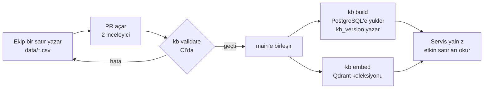

# 04 · Veri modeli

> **Durum:** ÖNERİ (18 Kasım 2026). Karar belgesi §4'teki hedef şemayı depodaki CSV gerçeğiyle birleştirir ve
> 4. toplantının iki açık işini (kural kaydı şeması, saklama-onay akışı) kapatmayı önerir (Ö-03, Ö-04).
> DDL: [schema.sql](schema.sql).

## 1. İlke: yazma modeli Git, okuma modeli PostgreSQL



- **Doğruluk kaynağı** `data/` altındaki dosyalardır. PostgreSQL ve Qdrant bunlardan üretilen, silinip yeniden
  kurulabilen **türetilmiş** depolardır. Elle PostgreSQL'e satır yazılmaz.
- **Onay kaydı** satırın kendi sütunlarında (`kontrol_eden_1`, `kontrol_eden_2`, `kontrol_tarihi`) ve onu ekleyen
  PR'da durur. Doğrulayıcı "iki alan dolu, iki ad farklı, ikisi de yazarın kendisi değil" koşulunu zorlar.
  Yazar bilgisi `yazan` sütunundadır.
- **Neden böyle?** Admin paneli v1'de yok (K10); onay ekranı yazmak yerine ekip zaten PR inceliyor. Denetim izi (kim,
  ne zaman, hangi kaynağa göre) Git geçmişinde kalıcıdır; jüri ve TÜBİTAK hakemi için gösterilebilir.
- **Ne zaman PostgreSQL'e geçilir?** Servis API'si yazılırken (M1). O zamana kadar servis aynı satırları CSV'den,
  aynı doğrulayıcıdan geçirerek okur; okuma arayüzü (`kb.load()`) değişmez, yalnız arkası değişir.

## 2. Varlıklar

| Varlık | Dosya (yazma) | Tablo (okuma) | Anahtar alanlar |
|---|---|---|---|
| Kavram | `data/sozluk/kavram.csv` | `concept` | `id` (`en:wheat`, `E102`), `type`, `name_tr`, `name_en`, `e_number`, `wikidata`, `source_id`; `cas`, `mesh_id` **hedef** alanlar (CTD içe aktarımıyla, M2 sonrası) |
| Üst kavram | `kavram.csv:ust_kavramlar` | `concept_parent` | `concept_id`, `parent_id` (IS_A; döngü yasak) |
| Takma ad | `data/sozluk/esanlamli.csv`, `ekip_esanlamli.csv` | `alias` | `concept_id`, `text`, `lang`, `relation`, `source_id`, `status`, `reviewer_1/2` (CSV'de `durum`, `onaylayan_1/2`; `esanlamli.csv`'de henüz yok, OFF satırları kaynak kaydıyla etkin) |
| Sağlık durumu | `data/kurallar/durumlar.csv` **(yeni)** | `condition` | `id` (`colyak`), `name_tr`, `mesh_id`, `coverage_note_tr`, `required_nutrition` |
| Kural | `data/kurallar/kurallar.csv` (bugün `kurallar_v0.csv`) | `rule` | §3 |
| Türetilmiş alan | `data/kurallar/turetilen_alanlar.csv` **(yeni)** | `derived_field` | `field`, `formula`, `source_id` (tuz → sodyum) |
| Kanıt (bilgi) | `data/kanit/*.csv` | `evidence` | `concept_id`, `condition_id`, `source`, `relation`, `url`, `source_version` |
| Kaynak | `data/kaynaklar.md` → `data/kaynaklar.csv` **(yeni, makinece okunur)** | `source` | `id`, `title`, `url`, `version_date`, `license`, `fields_taken`, `type` |
| Alerjen grubu | `data/sozluk/alerjen_gruplari.csv` **(yeni)** | `allergen_group` | `id`, `name_tr`, `concept_ids` (TGK Ek; K2 bilgi alanı) |
| Eşikler | `data/config/esikler.yaml` **(yeni)** | (yüklenir, tablo değil) | `fuzzy_cutoff`, `semantic.tau`, `semantic.delta`, `semantic.top_k`, `fixed_on`, `dev_split_hash` |
| KB sürümü | (üretilir) | `kb_version` | `id`, `git_commit`, `content_sha256`, `built_at`, `active_rule_count` |

**Saklanmayanlar (K1):** etiket metni, besin değerleri, profil, analiz sonucu. Şemada bu alanlara karşılık gelen tablo
yoktur ve olmayacaktır; [schema.sql](schema.sql) bu yüzden bir "request" tablosu içermez.

## 3. Kural kaydı şeması (Ö-03)

Bugünkü CSV sütunları ile karar belgesi §4 arasındaki fark kapatılır. **Altı kural türü** depodaki gerçektir:

| `kural_turu` | Ne zaman tetiklenir | Hedef | Örnek |
|---|---|---|---|
| `varlik` | Eşleşen bir içeriğin kavramı ya da üst kavramı hedefte | kavram kimlikleri | CEL-01 buğday → Uygun değil |
| `icerebilir` | "içerebilir" cümlesindeki bir ifade hedefte | kavram kimlikleri | CEL-02 → Dikkat |
| `beyan` | Yapılandırılmış ve olumsuz olmayan bir beyan var | beyan kodu (`gluten_free`) | CEL-03 → Engel bulunmadı |
| `miktar` | Besin değeri bir banda düşer | besin alanı | DM-01 şekerler > 5 g → Dikkat |
| `eksik_veri` | Miktar kuralının ihtiyacı olan alan yok | besin alanı | DM-02 → Doğrulanamadı + `missing_inputs` |
| `varsayilan` | Durumun başka hiçbir satırı tetiklenmedi | — | CEL-04 → Dikkat (çapraz bulaşma bilinmiyor) |

Sütunlar (yeni olanlar **kalın**):

```
kural_id, durum, kural_turu, hedef, **muaf**, **bantlar**, **bagimlilik**, sonuc,
aciklama_tr, kaynak_id, **kaynak_bolum**, **kaynak_turu**, **surum**,
**durum_satir** (taslak|etkin|emekli), yazan, kontrol_eden_1, kontrol_eden_2, **kontrol_tarihi**, not
```

- `muaf`: muaf kavramlar (bugün `parametre`'de `muaf=` ile). Muafiyet **alt bileşene de** uygulanır
  ("glikoz şurubu (buğday)", denetim D bölümü).
- `bantlar`: `kati`, `sivi` ya da ikisi için tek `her_ikisi` anahtarıyla `üst_sınır:sonuç` listesi; son adım zorunlu
  olarak `>` (bugün sessizce `None` dönebiliyor). `basis = per_100ml` ise `sivi`, değilse `kati` bandı kullanılır.
  Miktar satırlarının `sonuc` alanı boştur (bugünkü `(bant)` değeri taşımada silinir).
- `bagimlilik`: "yalnız şu kurallar tetiklenmediyse" listesi (bugün `yalniz_CEL01_…` alt dize eşleşmesi, CSV sırasına bağlı).
  Çözüm **iki geçişlidir**: 1. geçişte `bagimlilik`'i boş satırlar değerlendirilir; 2. geçişte `varsayilan` ve
  `bagimlilik`'li satırlar, 1. geçişin sonucuna bakarak değerlendirilir. `bagimlilik` yalnız aynı durumun 1. geçiş
  satırlarına başvurabilir; böylece döngü yapısal olarak imkânsızdır ve satır sırası sonucu etkilemez.
- `kaynak_turu`: `mevzuat | klinik_kilavuz | efsa_gorusu | ekip_karari`. "Ekip kararı" satırları uygulamada ayrı
  etiketle gösterilir; hakem ve kullanıcı neyin mevzuat, neyin ekibin ihtiyat kararı olduğunu görür.
- `sonuc` değerleri tam olarak dört Türkçe etiketten biri olmalı; yükleme sırasında enum'a karşı doğrulanır.
- `surum`: satır değiştiğinde artar (`1`, `2`…); yanıttaki `rule_version`.

### 3.1 Türkçe veri değeri ↔ İngilizce API değeri (Ö-11)

Dosyalar ve veritabanı Türkçe değeri, API İngilizce enum'u kullanır; dönüşüm yalnız `nutriscan/kb/codes.py` içindedir.

| Alan | Veri (CSV / DB) | API |
|---|---|---|
| Sonuç | Uygun değil · Dikkat · Engel bulunmadı · Doğrulanamadı | `NOT_SUITABLE` · `CAUTION` · `NO_ISSUE_FOUND` · `UNVERIFIED` |
| Kural türü | varlik · icerebilir · beyan · miktar · eksik_veri · varsayilan | `presence` · `may_contain` · `claim` · `amount` · `missing_data` · `default` (+ motorun `uncertainty`'si) |
| Kaynak türü | mevzuat · klinik_kilavuz · efsa_gorusu · ekip_karari | `regulation` · `clinical_guideline` · `efsa_opinion` · `team_decision` |
| Besin alanı | sekerler_g_100 · tuz_g_100 · sodyum_g_100 · karbonhidrat_g_100 | `sugars_g` · `salt_g` · `sodium_g` · `carbohydrate_g` (`basis` ile birlikte) |
| Katı / sıvı | kati · sivi | `basis = per_100g` · `per_100ml` |
| Beyan | glutensiz · laktozsuz · şeker ilavesiz · katkısız · koruyucu içermez | `gluten_free` · `lactose_free` · `no_added_sugar` · `additive_free` · `preservative_free` |

### 3.2 Yeni dosyaların biçimi

```
data/kurallar/durumlar.csv          durum_id, ad_tr, mesh_id, kapsam_notu_tr, gereken_besin (| ile)
data/kurallar/turetilen_alanlar.csv alan, kaynak_alan, bolen, kaynak_id          # sodyum_g_100, tuz_g_100, 2.5, eu-1169-2011
data/kaynaklar.csv                  kaynak_id, baslik, url, surum_tarihi, lisans, lisans_durumu, alinan_alanlar, tur, kontrol_eden
data/sozluk/alerjen_gruplari.csv    grup_id, ad_tr, kavram_id (| ile), kaynak_id
data/sozluk/dil_kaliplari.yaml      basliklar, beyanlar{kod: [kalıplar]}, olumsuzluk, icerebilir, baglaclar, cogul_istisnalari
data/sozluk/yasakli_ifadeler.yaml   yasakli: [...], izinli_sabit_metinler: [...]
data/config/esikler.yaml            fuzzy_cutoff, semantic{enabled, model, revision, top_k, tau, delta}, fixed_on, dev_split_sha256
```

`kaynaklar.md` insan okuması için kalır ve `kaynaklar.csv`'den üretilir; ikisi elle ayrı ayrı düzenlenmez.

## 4. Doğrulayıcı (`kb validate`) kuralları

Doğrulayıcı CI'da ve `kb build` öncesinde çalışır; herhangi biri ihlal edilirse yükleme yapılmaz.

1. Her `kaynak_id` `data/kaynaklar.csv`'de var, lisans alanı boş değil (kırmızı çizgi 7). `lisans_durumu` iki değer
   alır: `dogrulandi` ya da `arastirma_kullanimi`. İkincisi (bugün OFF taksonomileri) **uyarı** verir ama yüklemeyi
   durdurmaz; her rapor ve yanıt sürümünde bu durum görünür ve veri dağıtılmaz. Lisans `[..]` ise hata.
2. `durum_satir = etkin` ise iki inceleyici dolu, birbirinden ve `yazan`dan farklı; `kontrol_tarihi` dolu (K6).
3. `durum` değerleri `durumlar.csv`'de var; `durumlar.csv`'deki her durumun en az bir etkin satırı yoksa yanıtta
   kapsam notuyla Doğrulanamadı döner (bu hata değil, uyarı).
4. Her durum için `varsayilan` satırının sonucu "Engel bulunmadı" ise o durumda **`icerebilir` satırı da olmalı**
   (denetim A2'nin şemadaki karşılığı).
5. `bantlar` sözdizimi geçerli, sınırlar artan, son adım `>`.
6. `hedef` ve `muaf` içindeki her kavram `kavram.csv`'de var.
7. Kavram tablosunda tekrarlı kimlik yok; her üst kavram kimliği mevcut; IS_A döngüsü yok.
8. Bir takma ad birden çok kavrama gidiyorsa listelenir (hata değil; eşleyici `ambiguous` döner).
9. Etkin takma adlarda iki inceleyici dolu (`ekip_esanlamli.csv`); OFF kaynaklı satırlar kaynak kaydıyla etkindir.
10. Test kümesi ifadelerinin hiçbiri takma ad tablosunda yok (NFR-8; `eval/splits/test.sha256` ile).

## 5. Qdrant koleksiyonu

| Alan | Değer |
|---|---|
| Koleksiyon adı | `aliases__{model_kisa_adi}__{kb_content_sha8}`: model ya da KB değişince yeni koleksiyon, eskisi silinmeden durur (tekrarlanabilirlik) |
| Vektör | seçilen modelin boyutu, kosinüs benzerliği |
| Nokta kimliği | takma ad satırının kararlı karması (`sha1(concept_id + "|" + text)`) |
| Payload | `concept_id`, `alias_text`, `lang`, `concept_type`, `source_id` |
| İçerik | **yalnız etkin** takma adlar; test kümesi ifadeleri asla |

Sorgu her zaman `top_k = 5` ile yapılır; kabul kararı Qdrant'ta değil, C5'te verilir ([05](05-esleme-hatti.md)).

## 6. Bugünkü dosyalardan geçiş

| Adım | Ne | Davranış değişir mi? |
|---|---|---|
| 1 | `durumlar.csv`, `kaynaklar.csv`, `turetilen_alanlar.csv`, `esikler.yaml` oluşturulur; kod sabitleri buradan okunur | Hayır (aynı değerler) |
| 2 | `kurallar_v0.csv` → `kurallar.csv`: `parametre` sütunu `muaf`/`bantlar`/`bagimlilik`'e bölünür, yeni sütunlar eklenir, 17 satır `taslak` | Evet: ürün modunda bütün durumlar Doğrulanamadı olur, **doğru davranış budur** (hiçbir satır incelenmedi) |
| 3 | Hilal + ikinci inceleyici satırları kaynağına göre inceler, `etkin` yapar | Satır satır sonuç geri gelir |
| 4 | `kb build` PostgreSQL'e yükler; servis `NUTRISCAN_KB_BACKEND=postgres` ile okur | Hayır (aynı satırlar) |

**Bugünkü sütunlar → yeni sütunlar (adım 2'nin eşlemesi):**

| Bugün (`kurallar_v0.csv`) | Yeni (`kurallar.csv`) |
|---|---|
| `kural_id`, `durum`, `kural_turu`, `hedef`, `sonuc` | aynı (miktar satırında `sonuc` boşalır) |
| `parametre` = `muaf=…` | `muaf` |
| `parametre` = `kati:…;sivi:…` ya da `her_ikisi:…` | `bantlar` |
| `parametre` = `yalniz_…` | `bagimlilik` |
| `aciklama` | `aciklama_tr` |
| `kaynak` (serbest metin) | `kaynak_id` + `kaynak_bolum` (elle ayrıştırılır, inceleyici kontrol eder) |
| `dogrulama` ("AB metni doğrulandı; TR eki teyit bekliyor") | `not` (bilgi aynen korunur) |
| `kontrol_eden_1/2` | aynı + `kontrol_tarihi` |
| — | `kaynak_turu`, `surum` (=1), `durum_satir` (=taslak), `yazan` (Git geçmişinden) |
