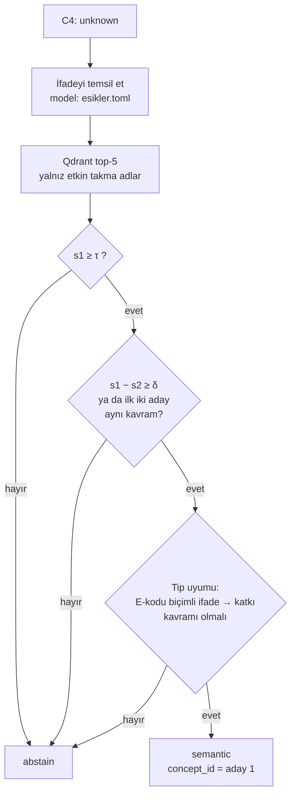

# 05 · Metin işleme ve eşleme hattı (C3, C4, C5)

> **Durum:** ÖNERİ (18 Kasım 2026). K4, K7, K8 ve TÜBİTAK 2.3'ü uygulanabilir algoritmaya çevirir. K7'deki
> "aday doğrulama" açık işini kapatma önerisi Ö-02'dir.

## 1. Taban yöntem (A) ve hibrit yöntem (B)

TÜBİTAK deneyinde karşılaştırılan iki ayar **aynı kod**dur; tek fark bir bayraktır:

| Ayar | Adımlar | Bayrak |
|---|---|---|
| A · Taban | C3 → C4 (E-kodu → birebir → çoğul → bulanık) → yoksa `unknown` | `semantic.enabled = false` |
| B · Hibrit | A + C4'ün `unknown` bıraktığı ifadeler için C5 | `semantic.enabled = true` |

Böylece gözlenen fark kod farkından değil yöntem farkından gelir.

## 2. C3 · Metin işleyici

Girdi: düzeltilmiş içindekiler metni. Çıktı: `Mention[]`, `MayContain[]`, `Claim[]`.

| Adım | Kural | Denetimdeki ilgili bulgu |
|---|---|---|
| 1. Unicode | `NFC` normalizasyonu, sonra Türkçe küçük harf (`I→ı`, `İ→i`) | A9 |
| 2. Başlık | "İçindekiler / Bileşenler / Ingredients" önekini at (büyük-küçük, ASCII yazım dahil) | A10 |
| 3. Yüzdeler | `%45`, `45 %`, `(%5)` atılır; miktar **saklanmaz** (kırmızı çizgi 4) | — |
| 4. Beyanlar | `dil_kaliplari.toml`'daki kalıplarla `Claim(code, text, negated)`: "glutensiz", "laktozsuz", "şeker ilavesiz"… Olumsuzluk kalıbı ("değil", "değildir", "içermez" değil): `negated = true` | A6 |
| 5. "İçerebilir" | Kalıp: `(eser miktarda)? X (ve|veya|,) Y içerebilir/bulunabilir`. **Yalnız kalıbın kapsadığı öğeler** "içerebilir" olur; kalıp cümle sınırı olmadan liste ortasında geçiyorsa, kalıptan önceki **son virgüle kadar** olan kısım kapsanır. Öncesi ana listede kalır | A5 |
| 6. Bölme | Parantez/köşeli parantez dışındaki `,` ve `;` | — |
| 7. Yapı | `baş (iç)` → baş + alt bileşenler (`parent_id`); `sınıf: madde` → sınıf + madde; "X içerir" → X | — |
| 8. Gürültü | Yalnız rakam/noktalama/tek harf kalan parça `noise` olur; **eşleşme sayılmaz, tanınan içerik de sayılmaz** | A1 |
| 9. Tür | Her ifadeye `expression_type`: önce kavram tipinden (C4 sonrası), yoksa kalıptan (`E\d+` → tekil kimyasal) | FR-3 |

Bütün kalıp ve kelime listeleri `data/sozluk/dil_kaliplari.toml` dosyasındadır; kodda Türkçe kelime listesi yoktur
(denetim C6).

## 3. C4 · Sözlük eşleyici

Sıra sabittir; ilk başarılı adım kazanır. Her adım `method` alanına yazılır.

1. **E-kodu:** `e 102`, `E-102`, `e450(i)` → `E102`, `E450`. Kavram yoksa `unknown` (bulanığa **gitmez**; A8).
2. **Birebir:** normalize metin etkin takma ad dizininde.
3. **Çoğul eki:** `-lar/-ler` (+ `-ı/-i`) atılmış gövde dizinde. Ünlü uyumu testleri: "aroma vericiler → aroma
   verici" geçer; gövdesi zaten "-lar/-ler" ile biten kelimeler ("eller") için istisna listesi `dil_kaliplari.toml`'da.
4. **Bulanık:** Ratcliff–Obershelp oranı (difflib), eşik `esikler.toml:fuzzy_cutoff`. Önce Türkçe takma adlar,
   sonra hepsi. E-kodu biçimindeki metin bu adıma girmez.
5. **Belirsizlik:** bir takma ad birden çok kavrama gidiyorsa `method = ambiguous`, `concept_id = null`, adaylar
   listelenir. Belirsiz eşleşme kural motoruna **tanınmayan** gibi girer (belirsizlik riski artırır).

**Etkin takma ad:** OFF kaynaklı satırlar (kaynak envanterde kayıtlıysa) + iki inceleyiciden geçmiş ekip satırları.
Taslak ekip satırları yalnız `--include-drafts` ile, deney raporunda açıkça belirtilerek kullanılır.

## 4. C5 · Anlamsal aday arama ve kabul kuralı (Ö-02)

- `s1`, `s2`: ilk iki adayın kosinüs benzerliği; **farklı kavramlara** ait ilk iki aday karşılaştırılır (aynı kavramın
  iki takma adı fark kuralını gereksiz yere düşürmesin).
- `τ` ve `δ` **yalnız geliştirme kümesinde** bir ızgara aramasıyla seçilir. Amaç: yanlış kabul oranı önceden
  belirlenen sınırın altındayken doğru eşleşmeyi en çoğa çıkarmak. Seçilen değerler `esikler.toml`'a yazılır,
  `fixed_on` tarihi ve geliştirme kümesi karması eklenir, test çalıştırılmadan önce commit'lenir.
- Model: başlangıç LaBSE (TÜBİTAK 2.3); İP3 başında en az bir alternatifle geliştirme kümesinde karşılaştırılır.
  Model adı ve revizyonu `esikler.toml:semantic.model`'dedir, koleksiyon adı ona bağlıdır ([04 §5](04-veri-modeli.md)).
- **TÜBİTAK 2.3'e ek:** tip uyumu ve "ilk iki aday aynı kavram" istisnası TÜBİTAK metninde yoktur; yanlış kabulü azaltan
  ihtiyat adımlarıdır ve İP1 protokolüne açıkça eklenmelidir (Ö-02).
- **LLM aday doğrulamaz.** Doğrulama deterministik kuraldır; insan doğrulaması gerekirse çevrimdışı olur:
  `abstain` kalan sık ifadeler haftalık bir listeyle ekibe gelir, ekip takma ad satırı olarak ekler (K8 adım 3), iki
  kişi inceler. Böylece sistem zamanla öğrenir ama hiçbir öğrenme çalışma anında, denetimsiz olmaz.
- Yanıtta adaylar ve puanlar `match.candidates` alanında görünür (şeffaflık).

## 5. Neden bu sıra?

| Soru | Cevap |
|---|---|
| Neden önce sözlük? | Açıklanabilir, deterministik ve hızlı; ön çalışmada ifadelerin çoğu burada çözülüyor. |
| Neden anlamsal arama yalnız `unknown` için? | Tanınan ifadeyi yeniden yorumlamak yanlış kabul riskini artırır; araştırma sorusu da tam bunu soruyor. |
| Neden eşik + fark? | Tek eşik, birbirine çok yakın iki kavram arasında "yazı tura" kabulüne izin verir (ör. sorbik asit ↔ askorbik asit, ön çalışmadaki bulanık hata). Fark kuralı bu durumda çekimser kalır. |
| Neden LLM değil? | K5/K13: sağlık sonucuna giden zincirde olasılıksal bir karar verici yok. |

## 6. Test edilebilirlik

- C3 için her kalıbın birim testi + `glutensiz değil`, noktasız "içerebilir", `I+U+0307`, ASCII başlık vakaları (A5, A6, A9, A10).
- C4 için E-kodu bulanık yasağı (A8), belirsiz takma ad, çoğul istisnası.
- C5 için sahte (mock) Qdrant ile kabul kuralının tüm dalları; gerçek Qdrant ile tek bir entegrasyon testi.
- Değerlendirme betiği A ve B ayarını aynı ayrım dosyasıyla çalıştırır ([09](09-degerlendirme-protokolu.md)).
