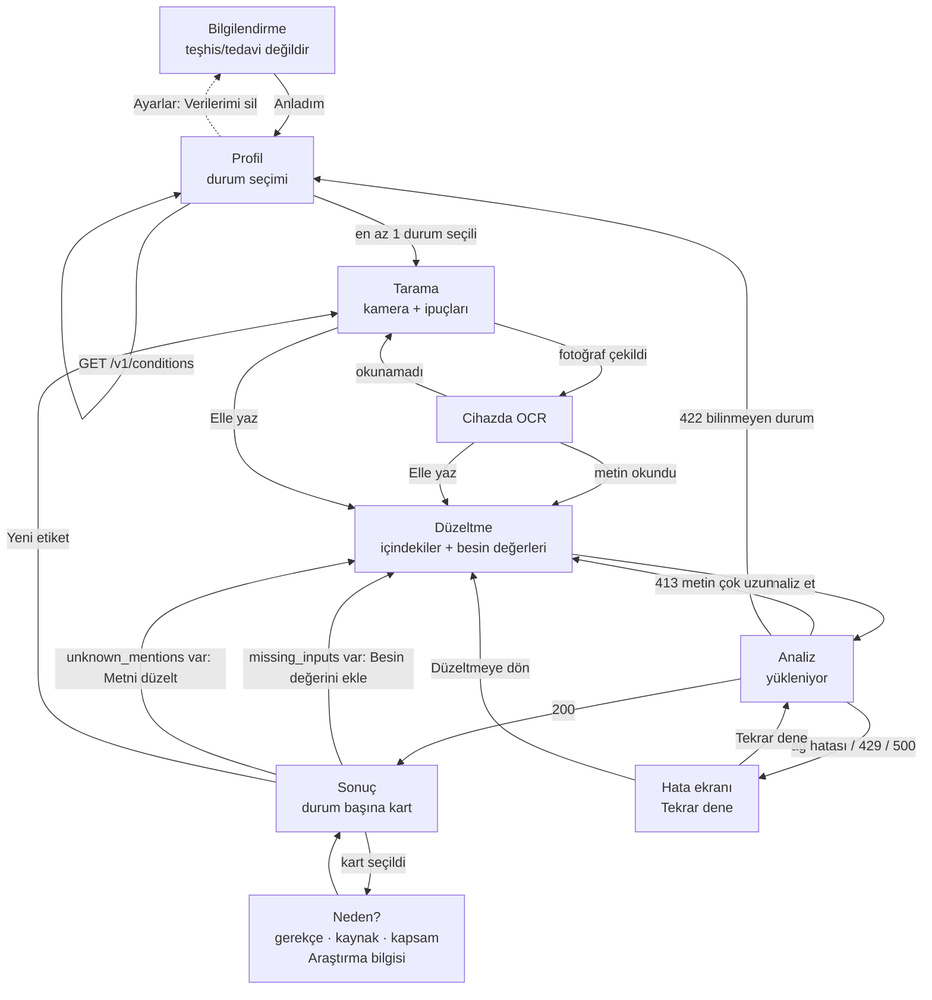

# 07 · Mobil uygulama (C1)

> **Durum:** ÖNERİ (18 Kasım 2026). Dayanak: karar belgesi v1.3 (K1, K2, K10, K11), [01-kapsam-ve-gereksinimler.md](01-kapsam-ve-gereksinimler.md)
> (FR-1, FR-2, FR-7, FR-8, FR-9, FR-11, FR-13, NFR-4, NFR-7, NFR-10), [02-mimari.md](02-mimari.md) §2, [openapi.yaml](openapi.yaml),
> [akış diyagramı](../akis-diyagrami.html) ve `AGENTS.md` kırmızı çizgileri. Bu belge yeni karar vermez; K10'u ekran ve
> bileşen düzeyine indirir. Karar gerektiren noktalar §10'da toplanır.

## 1. Amaç ve sınırlar

**Uygulama ne yapar.** Sağlık durumlarını seçtirir (telefonda saklar), etiket fotoğrafından cihazda metin okur, kullanıcıya
içindekiler metnini ve besin değerlerini düzelttirir, `POST /v1/analyses` çağırır ve dönen sonucu durum başına bir kart olarak
gösterir. Karttan "Neden?" ekranına inilir: gerekçe, kaynak belge ve bölüm, kapsam notu, tanınmayan ifadeler, araştırma bilgisi.

**Uygulama ne yapmaz.**

| Yapmaz | Dayanak |
|---|---|
| Web arayüzü ve admin paneli | K10 |
| Barkod okuma, ürün kütüphanesi, tarama geçmişi, favoriler | K1 |
| Sonucu kendisi hesaplamak, rozeti açıklama metninden türetmek, "benzer güvenli ürün" önermek | K5, K11, K3 |
| Fotoğrafı ya da ham OCR çıktısını sunucuya göndermek | K1, NFR-4 |
| Hesap, giriş, bulut yedek | FR-1 (profil yalnız telefonda) |
| Teşhis, tedavi, "güvenli/zararlı" dili | `AGENTS.md` kırmızı çizgi 2 |

Uygulama "ince istemci"dir: eşleme, kural ve sonuç sunucudadır; uygulamanın iş mantığı yalnız ekran durumu, doğrulama ve
sunumdur. Böylece ölçülen sistem ile gösterilen sonuç aynı koddur (02 §3 katman kuralı).

## 2. Ekran akışı



Akış notları:

1. **Bilgilendirme** yalnız ilk açılışta tam ekran gelir; sonra Ayarlar'dan okunur. Metin `disclaimer` alanıyla aynı
   anlamı taşır, sonuç ekranının altında da sabit görünür.
2. **Profil**: seçenekler `GET /v1/conditions` ile gelir (uygulamada sabit durum listesi yok, NFR-9 ile uyumlu). Her satır
   `name_tr`, `coverage_note_tr` ve `required_nutrition` bilgisini taşır. `active_rules = 0` olan durum seçilebilir kalır
   ve satırda "Bu durum için henüz onaylı kural yok; sonuç Doğrulanamadı olur" notu görünür (FR-13). Seçim hemen yerel depoya yazılır.
3. **Tarama**: kamera önizlemesi, ipuçları ("Paketin arkasındaki İçindekiler bölümünü çerçeveleyin", "Işık yansımasından kaçının",
   "Besin tablosunu ayrı fotoğrafla ekleyebilirsiniz") ve her zaman görünen "Metni elle yaz" bağlantısı.
4. **Düzeltme**: iki bölüm. (a) İçindekiler: çok satırlı metin alanı, en fazla 8000 karakter (API sınırı). (b) Besin değerleri:
   `basis` seçici (100 g / 100 ml) ve `Nutrition` alanları; boş bırakılan alan istekte **hiç gönderilmez** (değer uydurulmaz).
   Düzeltilmiş metin ve değerler yalnız bellekte tutulur.
5. **Sonuç → düzeltmeye dönüş** iki kısayol taşır: `missing_inputs` doluysa ilgili besin alanı vurgulanarak, `unknown_mentions`
   doluysa ilgili ifadeler listelenerek Düzeltme ekranı açılır; "Analiz et" yeniden aynı isteği yeni değerlerle gönderir.

## 3. Ekran başına durumlar

Her ekran dört temel durumu (loading / empty / error / content) ve ürüne özgü uç durumları tanımlar. Aynı tablo ekran görüntüsü
setinin (§8) kapsamıdır.

| Ekran | loading | empty | error | content ve uç durumlar |
|---|---|---|---|---|
| Bilgilendirme | yok (statik) | yok | yok | Metin + "Anladım". Onay yerel işaretlenir; geri dönülürse yeniden gösterilmez. |
| Profil | `GET /v1/conditions` sürerken iskelet satırlar | Liste boş döndü: "Desteklenen durum alınamadı" + Tekrar dene | Ağ hatası: son başarılı liste bellekte varsa onu göster ve "Liste güncellenemedi" notu; yoksa Tekrar dene | Durum satırları; kuralsız durum notla seçilebilir. Yerelde kayıtlı kimlik listede yoksa kimlik silinir, "X artık desteklenmiyor" bildirimi gösterilir. Seçim yokken "Tara" pasif ve nedeni yazılı. |
| Tarama | Kamera izni/başlatma: önizleme gelene kadar iskelet | İzin reddedildi: açıklama + "Ayarlar'ı aç" + "Metni elle yaz" | Kamera açılamadı: aynı çıkış yolları | Çekimden sonra OCR çalışırken "Metin okunuyor" (iptal edilebilir). **OCR boş ya da çok kısa dönerse**: "Metin okunamadı" + "Tekrar çek" + "Elle yaz". |
| Düzeltme | OCR sonucu gelene kadar alanlar kilitli iskelet | OCR boş ve elle yazma: boş alan, "Analiz et" pasif (içindekiler en az 1 karakter) | Doğrulama hatası satır içinde (negatif sayı, 100'ü aşan değer, 8000 karakter aşımı) | Tüm alanlar düzenlenebilir. **Besin tablosu yok**: alanlar boş kalabilir; "Besin değeri girmezseniz miktara bağlı kurallar Doğrulanamadı olur" notu görünür. Sonuçtan `missing_inputs` ile dönüldüyse ilgili alan vurgulu ve odakta. |
| Analiz | İlerleme göstergesi; 2 sn sonra "Sunucu yanıtı bekleniyor" | yok | Aşağıdaki hata tablosu | Yalnız geçici ekran; iptal düğmesi Düzeltme'ye döner, istek sonucu atılır. |
| Sonuç | (Analiz ekranı) | `results` boş gelemez; gelirse hata sayılır, "Sonuç alınamadı" | Aşağıdaki hata tablosu | Durum başına kart (§4). `explanation` yoksa Açıklama bölümü gizlenir, kartlar etkilenmez. Hepsi UNVERIFIED ise bkz. uç durum 3. |
| Neden? | yok (veri sonuç yanıtında) | `reasons` boşsa "Gerekçe kaydı yok" yerine kapsam notu gösterilir | yok | Bölümler: Gerekçeler, Kaynak, Eşleşen ifadeler (chip), Tanınmayan ifadeler, Kapsam, Araştırma bilgisi. Boş bölüm gizlenir. |

**Hata kodlarının eşlemesi** (kullanıcı metni i18n dosyasında):

| Olay | Kullanıcıya | Eylem |
|---|---|---|
| Ağ yok, zaman aşımı | "Sunucuya ulaşılamadı. Girdiğiniz bilgiler cihazınızda duruyor, hiçbir şey kaydedilmedi." | Tekrar dene · Düzeltmeye dön |
| 429 | "Çok sık denendi, biraz bekleyin." | Tekrar dene (geri sayım) |
| 413 | "İçindekiler metni çok uzun." | Düzeltme'ye dön, alan vurgulu |
| 422 | Geçersiz istek. Bilinmeyen durum kimliğiyse Profil listesi yenilenir | Profil ya da Düzeltme |
| 500 | "Bir sorun oluştu." + `request_id` kısa kodu (destek için) | Tekrar dene |

Ürüne özgü uç durumlar (ekranlardan bağımsız, her biri test senaryosudur):

1. **OCR okunamadı** → Tekrar çek ya da Elle yaz; ikisi de her zaman sunulur.
2. **`missing_inputs` dolu** (FR-7): kartta "Bu sonuç için besin değeri gerekli: şekerler" satırı, "Besin değerini ekle" düğmesi;
   düğme Düzeltme'yi ilgili alan odakta açar. Alan adları `required_nutrition` ile aynı kimliklerdir; ekran etiketi i18n'den gelir.
3. **Tüm kartlar UNVERIFIED ve `unknown_mentions` dolu**: Sonuç'un üstünde tek açıklama bandı: "Bazı ifadeler tanınmadı; bu yüzden
   sonuç Doğrulanamadı." + "Metni düzelt". Bant yalnız açıklar; rozet yine API'den gelir. Hepsi kuralsız durum yüzünden UNVERIFIED ise
   bant gösterilmez, kapsam notu yeterlidir.
4. **LLM kapalı ya da denetimden geçmedi** (FR-9): `generator = template`; uygulama bunu kullanıcıya ayrıca belirtmez, akışı bloklamaz,
   görünümü değiştirmez. `explanation` hiç gelmezse bölüm gizlenir.
5. **Kuralsız durum** (FR-13): kart UNVERIFIED; `coverage.note_tr` kartta kısaltmasız görünür.
6. **Alerjen grubu** (FR-11): Neden? ekranında eşleşen ifade chip'inin yanında "Alerjen grubu: …" bilgi etiketi; rozeti etkilemez.

## 4. Sonuç kartı tasarım kuralları

**Rozet (badge) kuralları.**

| API `outcome` | Metin (birebir) | Önem sırası | Simge (öneri) |
|---|---|---|---|
| `NOT_SUITABLE` | Uygun değil | 1 | Dolu daire içinde çarpı |
| `CAUTION` | Dikkat | 2 | Üçgen içinde ünlem |
| `UNVERIFIED` | Doğrulanamadı | 3 | Daire içinde soru işareti |
| `NO_ISSUE_FOUND` | Engel bulunmadı | 4 | Çizgili (outline) daire içinde yatay çizgi |

1. Rozet = **simge + metin + renk** üçlüsüdür; hiçbir durum yalnız renkle ayrışmaz (NFR-10). Renkler tema jetonudur
   (`color.outcome.*`), açık ve koyu temada metin/arka plan kontrastı ≥ 4,5:1 olmalıdır.
2. `NO_ISSUE_FOUND` için onay işareti (check) ve yeşil dolgulu "başarı" görünümü kullanılmaz; çünkü bu görünüm "güvenli" anlamı
   taşır, oysa sonuç yalnız "kontrol edilen kurallarda engel bulunmadı"dır. Kartta bu sonucun altında kapsam notu **her zaman** görünür.
3. **Rozet yalnız `results[].outcome` alanından** çizilir. Açıklama metni, `reasons[].detail` ya da herhangi bir dizeden rozet
   türetilmez; metinde "uygun değil" geçmesi rozeti etkilemez. Metin, `outcome` enum'undan i18n tablosuyla üretilir; sunucudan gelen
   `outcome_label_tr` ile eşitliği bir birim testi denetler, uyuşmazlıkta enum esas alınır ve test kırılır.
4. **Yasak sözcükler** (`güvenli`, `zararlı`, `tetikler`, `tedavi`, `önler` ve teşhis dili) arayüz metinlerinde yoktur: i18n dosyası
   üzerinde bir test (kök ve ek biçimleriyle, büyük/küçük harf duyarsız; Türkçe `İ/ı` normalizasyonu dahil) bu sözcükleri tarar.
   Yasal bilgilendirme metni ("teşhis ya da tedavi amacı taşımaz") ve dört sonuç etiketi bir **izin listesindedir**; tarama bunları
   çıkardıktan sonra yapılır, yoksa test kendi zorunlu metnine takılır.
   Sunucudan gelen metin (`explanation`, `detail`) sunucuda denetlenir (NFR-5); uygulama ikinci savunma olarak aynı taramayı
   uygular ve eşleşirse metni göstermez, kart gerekçesini şablon yedeğiyle gösterir [..] davranış ekiple netleşecek (§10, Q5).
5. **Kart içeriği** (yukarıdan aşağı): durum adı (`name_tr`) · rozet · tek satır özet (`reasons[0].detail`) · kapsam notu ·
   `missing_inputs` varsa uyarı satırı · "Neden?" düğmesi (tüm kart dokunulabilir, ≥ 44 pt).
6. **Sıralama:** `NOT_SUITABLE` > `CAUTION` > `UNVERIFIED` > `NO_ISSUE_FOUND`; eşit önemde kartlar profildeki seçim sırasını korur.
   Sıralama istemcide yapılır, API sırasına bağlı değildir. Hiçbir kart gizlenmez ya da daraltılmaz; "Engel bulunmadı" kartları da görünür.
7. **Açıklama bölümü:** kartların altında tek blok, başlık "Açıklama" (yanıttaki `explanation.text_tr`). Rozetten sonra okunur,
   rozetin yerini tutmaz. `explanation` yoksa blok yok; kartlar kendi başına eksiksizdir. Bloğun altında sabit `disclaimer` metni.
8. **Araştırma bilgisi** yalnız Neden? ekranında, ayrı başlık altında ve "Bu bilgi sonucu etkilemez" cümlesiyle verilir (FR-8, K5);
   kayıtlar `source` (CTD/JECFA), `relation`, `source_version` ve harici bağlantıdır. Kartta ve rozette araştırma bilgisi görünmez.

## 5. Veri ve gizlilik

| Veri | Nerede | Süre |
|---|---|---|
| Seçili durum kimlikleri (profil) | Yalnız telefonda, kalıcı yerel depo | Kullanıcı silene dek |
| Etiket fotoğrafı | Bellek / geçici dosya; **hiçbir yere yüklenmez**; OCR bitince silinir | Oturum |
| OCR ham metni, düzeltilmiş metin, besin değerleri | Yalnız ekran durumu (bellek); diske yazılmaz | Oturum |
| Sunucuya giden | Düzeltilmiş `ingredients_text`, `nutrition`, durum kimlikleri; HTTPS | Tek istek |
| Sonuç yanıtı | Bellekte; uygulama kapanınca gider (tarama geçmişi yok, K1) | Oturum |

**Yerel depo seçenekleri (ÖNERİ):**

| Seçenek | Artı | Eksi |
|---|---|---|
| `expo-secure-store` (iOS Keychain / Android Keystore) | Sağlık durumu hassas veridir; cihaz şifreli deposunda durur; yedeklemeye düşme davranışı platform kuralına bağlı | Değer boyutu ve platform sınırları vardır [..] denemede doğrulanacak; sorgu özelliği yok |
| `@react-native-async-storage/async-storage` | Basit, sınırsıza yakın boyut | Şifresiz düz depo; cihaz yedeğinde okunabilir olabilir [..] denemede doğrulanacak |

**Öneri: `expo-secure-store`.** Profil yalnız birkaç durum kimliğidir (küçük JSON), boyut sorun olmaz; sağlık durumu bilgisi
için şifreli depo, ek maliyet olmadan daha savunulabilir bir seçimdir. AsyncStorage yalnız hassas olmayan tercih için
(ör. bilgilendirmenin onaylandığı) kullanılabilir. Karar [..] Q2'de.

Diğer kurallar:

- **Analitik / izleme SDK'sı yok** (PII ya da sağlık verisi toplayan hiçbiri). Çökme raporlaması gerekirse yalnız kimliksiz,
  istek gövdesi ve profil içermeyen bir araç, ekip kararıyla (Q6).
- Uygulama **istek gövdesini, durum listesini ve etiket metnini** konsola ve hata raporlarına yazmaz; geliştirme günlüğü yalnız
  `request_id`, durum kodu ve süre taşır (02 §5.4 ile aynı alanlar).
- Ağ katmanı yalnız HTTPS kullanır. Yerel demo `http://` ile yapılacaksa bu bilinçli bir istisnadır (Q4).
- **Verilerimi sil** (Ayarlar): yerel depodaki profili ve bilgilendirme onayını siler, bellekteki taslakları atar, uygulamayı Bilgilendirme'ye döndürür.
  Silinecek sunucu verisi olmadığı için ekranda "Sunucuda sizinle ilgili kayıt tutulmuyor" yazar.

## 6. OCR yaklaşımı

K10: OCR cihazda yapılır, kütüphane ilk 20 gerçek etiketle denenip seçilir. Bu belge kütüphane seçmez; aday kategorileri ve
deneme protokolünü tanımlar.

**Aday kategoriler** (paket adı ve sürümü bilerek yazılmadı; denemeden önce kaynağından doğrulanacak):

| Kategori | Not |
|---|---|
| Platform metin tanıma, topluluk React Native modülü üzerinden: Android'de ML Kit metin tanıma, iOS'ta Apple Vision | Cihazda çalışır, fotoğraf cihazdan çıkmaz. Hangi topluluk modülünün bakımda ve Expo uyumlu olduğu, Türkçe karakter desteği [..] denemede doğrulanacak |
| Kendi küçük yerel modülümüz (Expo modül API'si) ile iki platform kütüphanesini sarmak | Daha fazla iş; topluluk modülü yetersizse yedek yol [..] doğrulanacak |
| Bulut OCR | **Aday değil**: fotoğraf cihazdan çıkar (K1, NFR-4) |

**Expo Go sınırı:** yerel (native) modül gerektiren her aday **development build** ile çalışır; Expo Go ile denenemez [..] her aday
için doğrulanacak. Bu yüzden OCR denemesine başlamadan önce bir development build hattı (iOS simülatörü + en az bir gerçek telefon,
kamera için gerçek cihaz şart) kurulur. Profil, düzeltme ve sonuç ekranları OCR'dan bağımsız yazılır ve Expo Go'da çalışabilir olmalıdır.

**Deneme protokolü (kod yazmadan önce yazılır, sonuç görüldükten sonra değiştirilmez):**

1. **Küme:** 20 gerçek etiket, ekibin elindeki ürünlerden; en az 5'i parlak ambalaj, en az 3'ü kavisli yüzey, en az 3'ü küçük
   punto, en az 2'si çok dilli etiket. Her etiket için içindekiler bloğunun **elle yazılmış referans metni** (biri yazar, öbürü kontrol eder).
2. **Çekim:** her etiket aynı koşulda (ışık, uzaklık) bir kez, ek olarak "kötü" koşulda (yansıma ya da eğik) bir kez; iki cihazda
   (bir iOS, bir Android) [..] cihazlar ekipte belirlenecek.
3. **Metrik 1: karakter hata oranı (CER)** = (ekleme + silme + değiştirme) / referans karakter sayısı, Levenshtein ile,
   yalnız içindekiler bloğunda. Normalizasyon önceden sabitlenir (Türkçe kurallı küçük harf, boşluk birleştirme); ham ve
   normalize CER ikisi de raporlanır. `ç ğ ı İ ö ş ü` hatası ayrıca sayılır.
4. **Metrik 2: süre**: çekimden metne ms, aday ve cihaz başına medyan ve en kötü değer. NFR-7'nin 3 sn bütçesi OCR sonrası
   başlar; OCR süresi ayrı raporlanır.
5. **Metrik 3 (ikincil):** içindekiler bloğunu ayırabiliyor mu, yoksa tüm ambalaj metnini mi veriyor (kullanıcı düzeltme yükünü etkiler).
6. **Karar ölçütü denemeden önce yazılır:** kabul eşiği ve bağ bozma sırası (ör. önce CER, sonra süre, Türkçe karakter hatası veto)
   [..] ekip belirleyecek; sayı bu belgede uydurulmaz.
7. **Karar kaydı** (`docs/arastirma/ocr-deneme.md`, bir sayfa):

   | Alan | İçerik |
   |---|---|
   | Tarih, cihazlar, işletim sistemi sürümleri | |
   | Aday | ad, **doğrulanmış** sürüm, lisans, bakım durumu |
   | Sonuç tablosu | etiket × aday: CER (ham/normalize), süre |
   | Karar | seçilen aday ve neden, elenenler ve neden |
   | Bilinen sınırlar | hangi etiket tipinde başarısız |
   | Geri dönüş | OCR yetersizse elle yazma akışı zaten birinci sınıf (§9) |

## 7. Teknik yapı

**Gezinme: `expo-router` (dosya tabanlı) önerilir.** Ekran akışı §2'deki küçük, doğrusal bir ağaçtır; dosya yolu ekran adı olur,
derin bağlantı ve tür güvenli yönlendirme ek kurulum istemez; Expo'nun varsayılan şablonu olduğu kurulumda [..] doğrulanacak. Alternatif React Navigation'ı
elle kurmaktır; v1'in on ekranlık akışı için ek getirisi yok. [..] sürüm uyumu kurulumda doğrulanacak.

```
app/
  app/                      expo-router rotaları (ince; yalnız ekranı çağırır)
    _layout.tsx
    index.tsx               açılış yönlendirmesi (onay yoksa onboarding)
    onboarding.tsx
    profile.tsx
    scan.tsx
    review.tsx              düzeltme
    analyzing.tsx
    results.tsx
    results/[conditionId].tsx   Neden?
    settings.tsx
  src/
    api/                    openapi tabanlı tipler + client (analyses, conditions)
    features/{profile,scan,review,results}/   ekran bileşenleri + hook'lar
    components/             OutcomeBadge, ConditionCard, NutritionField, MentionChip…
    state/                  analysisDraft store, profile store
    ocr/                    OcrEngine arayüzü + seçilen aday + elle yazma boş uygulaması
    i18n/tr.ts              tüm kullanıcı metinleri
    theme/                  renk jetonları (açık/koyu), boşluk, yazı ölçeği
    config/                 env okuma
  __tests__/  e2e/
```

- **Durum yönetimi:** önce React state + context; paylaşılan iki parça (kalıcı profil, bellekteki `analysisDraft`) için küçük
  bir store kütüphanesi (aday: Zustand) yeterlidir. Redux ve benzeri v1'de gereksizdir: ekran sayısı az, sunucu önbelleği yok
  (geçmiş saklanmaz), paylaşılan durum iki parçadır. `analysisDraft` diske yazılmaz (§5).
- **API istemcisi:** `openapi.yaml`'dan tip üretimi (aday: `openapi-typescript`) ve üzerinde ince bir `fetch` sarmalayıcı; elle
  yazılmış tip yok, sözleşme değişince derleme kırılır. Aday araçların OpenAPI 3.1 desteği [..] doğrulanacak. Sarmalayıcı zaman aşımı,
  Problem (RFC 9457) çözümü ve istek gövdesi loglamama kuralını taşır.
- **Yapılandırma:** API tabanı adresi `app.config` ve ortam değişkeninden okunur (aday: `EXPO_PUBLIC_` önekli değişken
  [..] doğrulanacak); kodda adres yok. Eşik, durum listesi, dosya yolu uygulamada sabit yazılmaz (NFR-9). Sır uygulamaya girmez (kırmızı çizgi 6).
- **i18n:** bütün kullanıcı metinleri `src/i18n/tr.ts` içinde; bileşenlerde sabit metin yok (lint kuralı ya da `rg` taraması).
  Dil tek (tr-TR) ama anahtarlı yapı, yasak sözcük testini (§4) tek noktada çalıştırır. Kodda ve tanımlayıcılarda İngilizce, metinde Türkçe.
- **Erişilebilirlik kontrol listesi** (her PR'da ekran görüntüsüyle birlikte işaretlenir):
  - [ ] Dokunma hedefleri ≥ 44 pt (düğme, kart, chip, odak halkası).
  - [ ] Dinamik yazı boyutu: sistem ölçeğinin en büyük değerinde kırpılma ve üst üste binme yok; kaydırma mümkün.
  - [ ] Ekran okuyucu: her rozet "Çölyak, Uygun değil" biçiminde tek ifadeyle okunur (`accessibilityLabel`); simgeler dekoratif işaretlenir; kamera ve düğmeler etiketli.
  - [ ] Kontrast ≥ 4,5:1 (metin) açık ve koyu temada; sonuç yalnız renkle ayrışmaz (NFR-10).
  - [ ] Hareketi azalt (reduce motion) tercihine saygı: yükleme ve geçiş animasyonları kapanır.
  - [ ] Odak sırası mantıklı; hata mesajı ilgili alana bağlanır ve okunur.

## 8. Test

| Katman | Kapsam | Araç (aday) |
|---|---|---|
| Birim | rozet eşlemesi (4 enum → metin/simge), sıralama, yasak sözcük taraması, `Nutrition` istek kurucusu (boş alan gönderilmez), hata eşlemesi | Jest [..] doğrulanacak |
| Bileşen | `OutcomeBadge`, `ConditionCard` (missing_inputs, kapsam notu), Neden? bölümleri (boş bölüm gizlenir), Düzeltme doğrulama | React Native Testing Library [..] |
| Sözleşme | `openapi.yaml` örnek yanıtı ekran modeline hatasız dönüşür; `outcome_label_tr` ile i18n eşitliği | Jest + üretilmiş tipler |
| E2E mutlu yol | Simülatörde: onboarding → çölyak + diyabet seç → elle metin yaz → besin gir → sonuç → Neden? | Aday: Maestro ya da Detox [..] seçim denemeyle; seçim ekipte, tek araç |
| Gizlilik | Çalışma sırasında kaydedilen ağ isteklerinde yalnız beklenen alanlar var; konsol çıktısında etiket metni yok | E2E içinde denetim |

**Ekran görüntüsü seti:** UI'ya dokunan her PR, değişen ekranın en az 4 durumunu (loading, empty, error, content; ürüne özgü uç
durum varsa o da) açık ve koyu temada ekler; görüntüler PR açıklamasında durur, repoya ikili dosya olarak eklenmez (Q7). Yanıt
örnekleri `openapi.yaml`'dan ve sahte (mock) sunucudan alınır; böylece servis hazır olmadan da ekranlar geliştirilir.

## 9. Teslim aşamaları

**CSE 491 finali (~18 Aralık 2026) [tarih teyit edilmedi]: asgari kapsam.**

| # | Teslim | Kabul ölçütü |
|---|---|---|
| A1 | Bilgilendirme + Profil (`GET /v1/conditions`, yerel depo, kapsam notları) | FR-1: profil yalnız telefonda; sunucu isteğinde durum kimliğinden başka profil alanı yok |
| A2 | Metin girişi + Düzeltme (içindekiler + besin değerleri, `basis`) | FR-2 (düzeltme kısmı): her alan düzenlenebilir |
| A3 | Analiz çağrısı + Sonuç kartları + Neden? | FR-8, FR-13; §4 kuralları; 4 durumlu ekran görüntüsü seti |
| A4 | Uç durumlar: `missing_inputs`, `unknown_mentions`, hata tablosu | FR-7; §3 senaryoları E2E ve bileşen testlerinde |
| A5 | Erişilebilirlik kontrol listesi | NFR-10 |

OCR bu asgari kümede **koşulsuz değildir**: K10 ve karar belgesi §9'a göre mobil OCR demoda yalnız uygulama hazırsa yer alır;
değilse düzeltilmiş metin doğrudan yazılır. Bu yüzden elle yazma akışı A2'de birinci sınıf yapılır, OCR sonradan `OcrEngine`
arayüzünün arkasına takılır ve elle yazma her zaman açık kalır. OCR denemesi (§6) A1–A3 ile paralel yürür; seçilirse
**A6: Tarama ekranı + cihazda OCR** eklenir (development build, gerçek cihaz).

**CSE 492 uzantıları:** OCR kalitesi iyileştirmesi (kırpma/döndürme ön işleme, içindekiler bloğunu otomatik ayırma);
besin tablosunu ayrı fotoğraftan okuma; `explanation` için akışlı yanıt (v2, 02 §4); gerçek cihaz kullanılabilirlik sınaması
(küçük kullanıcı grubu, görev tamamlama süresi); mağaza dağıtımı ya da TestFlight/dahili test dağıtımı; erişilebilirlik denetimi
gerçek ekran okuyucuyla; bilgi tabanı genişledikçe durum listesi kapsamının gösterimi.

## 10. Açık sorular

| # | Soru | Kim karar verir |
|---|---|---|
| Q1 | OCR kütüphanesi hangisi, kabul ölçütü ve eşiği nedir (§6 madde 6)? | Hep birlikte (OCR deneme sahipliği karar belgesi §8); karar kaydını Levent işler |
| Q2 | Yerel depo `expo-secure-store` mı AsyncStorage mı (§5 öneri: secure-store)? | Levent önerir, ekip Çarşamba senkronunda onaylar |
| Q3 | Demo cihazları ve OCR denemesi için iOS/Android cihaz dağılımı nedir? | Ekip (cihaz sahipliği) |
| Q4 | Yerel demo `http://` ile mi yapılacak yoksa HTTPS tüneli mi? Platformlar düz HTTP'yi varsayılan engeller [..] doğrulanacak; ayrıca §5'teki "yalnız HTTPS" kuralıyla çakışır | Levent (platform/mimari), danışmana bilgi |
| Q5 | Sunucudan gelen metin yasak sözcük taramasına takılırsa istemci ne yapar: şablon yedeği mi, metni gizleme mi? Şablon metin sunucuda olduğu için istemci yedeği ne içerir? | Levent + Hilal (dil güvenliği kuralları) |
| Q6 | Çökme raporlama aracı kullanılacak mı (PII'siz)? Varsayılan: hayır | Ekip |
| Q7 | Ekran görüntüleri ve OCR deneme fotoğrafları (ürün ambalajı) repoya girer mi, yoksa yalnız PR/yerel mi? Ürün fotoğrafı lisans/telif açısından `data/kaynaklar.md` kuralına tabi mi? | Hilal (lisans envanteri) + Levent |
| Q8 | Yanıtı gecikmeli gösterme: 02 §4'teki "explanation gelmeden kartları göster" tek istekle mümkün değil; v1'de tek yanıt beklenir mi? (öneri: evet, zaman aşımı 2 sn sunucuda) | Levent (API sahibi) |
| Q9 | Bilgilendirme ve Neden? ekranındaki sabit metinlerin (teşhis/tedavi değildir, kapsam sınırları) son hali kim yazar ve inceler? | Levent yazar, Hilal ve Ozan bağımsız inceler (kırmızı çizgi 2) |
