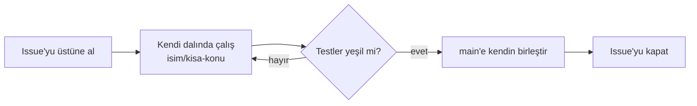

# 10 · Çalışma düzeni

> **Durum:** KARAR (21 Kasım 2026, sadeleştirildi). Günlük kurallar kökteki [PLAN.md](../../PLAN.md)'de beş maddedir; bu belge
> yalnız "bitti ne demek", kod standartları ve agent kuralları için ayrıntı verir. **PR onayı yoktur.**

## 1. Bir iş nasıl akar

Herkes kendi klasöründe çalıştığı için ([PLAN.md](../../PLAN.md) "Kim neyle ilgileniyor") çakışma beklenmez. Başkasının
klasöründe değişiklik gerekiyorsa o kişiye söylenir.

## 2. Bitti ne demek

- Issue'daki "bitti sayılır" maddesi sağlandı (test ya da ekran görüntüsü).
- Testler yeşil (`.venv/bin/python -m unittest discover -s tests`; CI aynısını çalıştırır).
- Kodda yeni sabit değer yok: eşik, dosya yolu, durum adı, Türkçe kelime listesi dosyadan gelir.
- Yeni veri eklendiyse kaynağı `data/kaynaklar` listesinde.
- Davranış değiştiyse ilgili `docs/tasarim/` belgesi de güncellendi.
- Commit mesajında AI imzası ya da araç adı yok.

**Kural ve çeviri satırları için tek ek kural (K6):** bir satır, iki kişinin adı satırdaki `kontrol_eden_1` ve
`kontrol_eden_2` alanlarına yazılmadan `etkin` yapılmaz. Bu bir PR onayı değildir; satırı yazan kişi kontrol edenlerden
biri olamaz.

## 3. Commit ve dal

- Dal: `isim/kisa-konu` (ör. `ozan/metin-duzeltmeleri`). Kısa ömürlü; bitince silinir.
- Commit: Conventional Commits, İngilizce başlık (`fix(rules): never return no-issue-found without recognised ingredients`).
- Gün başında `git pull --rebase origin main`.

## 4. Kod standartları

| Konu | Kural |
|---|---|
| Python | 3.12; `pyproject.toml` + `uv`; `ruff`; tip ipuçları; alan nesneleri `dataclass` |
| Test | `unittest` (mevcut) ya da `pytest`; her hata düzeltmesine bir test |
| Yapılandırma | eşikler `data/config/esikler.toml`, ortam ayarları ortam değişkeninde (`.env` depoya girmez) |
| Log | etiket metni ve sağlık profili loglanmaz (NFR-4) |
| Mobil | TypeScript; bütün metinler i18n dosyasında |
| Belgeler | Türkçe; kod ve tanımlayıcılar İngilizce |

Paket adları "aday"dır; ilk kurulumda sürümler sabitlenir ve kilit dosyası (`uv.lock`, `package-lock.json`) commit'lenir.

## 5. Agent kuralları (Claude Code, Codex, Antigravity)

AGENTS.md geçerlidir; ek olarak:
1. Agent'a issue numarasını ve ilgili tasarım bölümünü ver; agent önce onları okur.
2. Agent yalnız kendi kişisinin klasörlerinde değişiklik yapar.
3. Agent kural ya da çeviri satırını `etkin` yapamaz; iki isim alanını yalnız insanlar doldurur.
4. Agent `data/config/esikler.toml` ve `eval/splits/` dosyalarını kendiliğinden değiştirmez.
5. Kural motoru değişmez testleri (06 §2, D1–D10) silinmez, atlanmaz.
6. Sürüm, API ya da kaynak uydurulmaz; doğrulanamayan yere `[..]` yazılır ve söylenir.

## 6. Toplantılar

- **Çarşamba ekip toplantısı (30 dk):** `PLAN.md` üzerinden: kim ne bitirdi, ne takıldı, sonraki hafta.
- **Cuma danışman görüşmesi:** biten işlerin kısa demosu; Meeting Record formu o gün doldurulur ve `toplanti/` altına girer
  (kayıt sorumlusu dönüşümlü: Levent → Hilal → Ozan).
