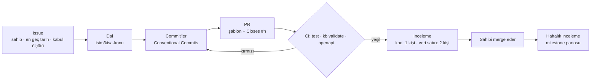

# 10 · Çalışma düzeni (süreç, kalite, agent kuralları)

> **Durum:** ÖNERİ (18 Kasım 2026). K12'yi ayrıntılandırır; Ö-07 (Issues) ve Ö-10 (hafif CI) kabul edilirse
> geçerlidir. Amaç: üç kişi ve üç farklı agent aynı standartta, birbirinin işini bozmadan çalışsın.

## 1. İşin yaşam döngüsü



## 2. Hazır tanımı (Definition of Ready)

Bir issue üzerinde çalışmaya başlanabilmesi için:
- Kabul ölçütü test edilebilir biçimde yazılmış (girdi → beklenen çıktı).
- İlgili tasarım bölümü bağlantılı (ör. `docs/tasarim/06-kural-motoru.md §2 D2`).
- Bağımlı olduğu iş bitmiş ya da kullanılabilir bir sahte (mock) var.
- Karar belgesine aykırı değil; aykırıysa önce Ö-önerisi açılır.

## 3. Bitti tanımı (Definition of Done)

- [ ] Kabul ölçütünün her maddesi bir testle ya da ekran görüntüsüyle kanıtlı.
- [ ] `make check` yeşil: birim testleri, `kb validate`, `ruff`, OpenAPI denetimi.
- [ ] Kodda yeni sabit değer yok (eşik, yol, durum adı, Türkçe kelime listesi; NFR-9).
- [ ] Yeni veri varsa `data/kaynaklar.csv`'de kaydı var (kırmızı çizgi 7).
- [ ] Kural ya da takma ad satırıysa iki farklı inceleyici dolu (K6).
- [ ] Davranış değiştiyse ilgili tasarım belgesi aynı PR'da güncellendi.
- [ ] Commit ve PR'da AI imzası ya da araç adı yok.

## 4. Dal, commit, PR

- Dal: `<isim>/<kisa-konu>` (ör. `levent/motor-degismezleri`), kısa ömürlü, sahibi merge eder.
- Commit: Conventional Commits, İngilizce başlık (`fix(rules): never return no-issue-found without recognised ingredients`).
- PR şablonu (`.github/pull_request_template.md`): **Ne** · **Neden** (issue ve tasarım bağlantısı) ·
  **Nasıl doğrulandı** (komut + çıktı) · **Risk** · **İnceleyene 3 soru**.
- İnceleme: kod PR'ı en az 1 kişi; `data/kurallar/` ya da `ekip_esanlamli.csv` değişikliği **2 kişi**
  (`CODEOWNERS` ile zorlanır).

## 5. Kod standartları

| Konu | Kural |
|---|---|
| Python | 3.12; `pyproject.toml` + `uv`; `ruff` (lint + format); tip ipuçları zorunlu, alan nesneleri `dataclass` ya da `pydantic` |
| Test | `pytest` (mevcut `unittest` testleri olduğu gibi çalışır); özellik testi için `hypothesis` (aday) |
| Yapılandırma | `pydantic-settings`; eşikler `data/config/esikler.yaml` |
| Log | `structlog` ya da standart `logging` + JSON biçimci; yasaklı alanlar filtrelenir (NFR-4) |
| Mobil | TypeScript `strict`; ESLint + Prettier; bütün metinler i18n dosyasında |
| Belgeler | Türkçe; kod ve tanımlayıcılar İngilizce; tasarım değişikliği aynı PR'da |

Paket adları "aday"dır; M1'de sürümleri sabitlenir ve `uv.lock` / `package-lock.json` commit'lenir.

## 6. Tek komutlar

```
make setup        # uv sync + pre-commit kurulumu
make check        # ruff + pytest + kb validate + openapi lint
make kb           # kb build (PostgreSQL) + kb embed (Qdrant)
make up           # docker compose up (servis + PostgreSQL + Qdrant)
make eval M=A     # değerlendirme, yöntem A ya da B
```

## 7. Agent kuralları (Claude Code, Codex, Antigravity)

AGENTS.md geçerlidir; ek olarak:
1. Bir işe başlamadan önce issue, ilgili tasarım bölümü ve karar belgesi okunur; plan PR açıklamasına yazılır.
2. Agent **veri satırını etkinleştiremez**: `durum_satir = etkin` ve inceleyici alanlarını yalnız insan doldurur.
3. Agent test eşiğini, `esikler.yaml`'ı ya da `eval/splits/` dosyalarını değiştiremez; değişiklik önerisi issue olur.
4. Değişmezler (D1–D10) testlerini silmek ya da atlamak (`skip`) yasaktır.
5. Sürüm, API ya da kaynak uydurulmaz; doğrulanamayan yere `[..]` konur ve PR'da söylenir.

## 8. Toplantı ritmi

- **Çarşamba ekip senkronu (30 dk):** milestone panosu, kırmızı CI'lar, Ö-önerileri oylaması, inceleme bekleyen
  veri satırları (sabit 10 dk; denetim "inceleme birikmesi" riskine karşı).
- **Cuma danışman:** tamamlanan milestone'un demosu; Meeting Record formu aynı gün doldurulur ve `toplanti/` altına
  `YYYY-AA-GG-toplanti-N-kaydi.md` olarak girer.
