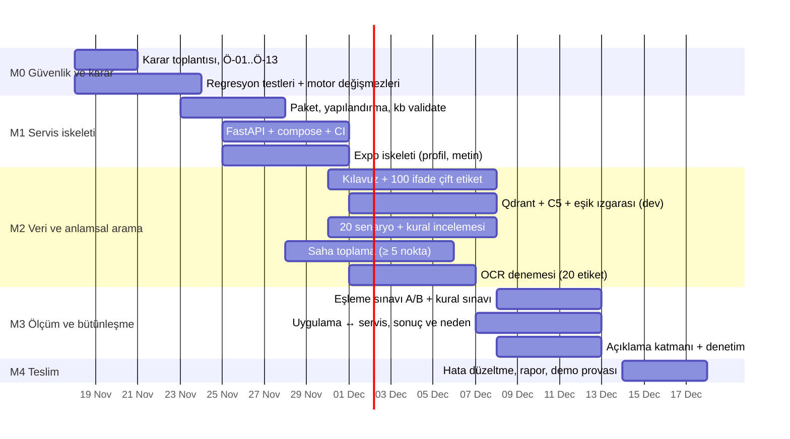

# 11 · Yol haritası ve iş kırılımı (18 Kasım → 18 Aralık 2026 ve sonrası)

> **Durum:** ÖNERİ (18 Kasım 2026). Hafta numaraları proposal'ı izler (Hafta 1 = 14 Eylül 2026; bugün Hafta 10).
> Sabit noktalar: Meeting Record 5 → **27 Kasım**; CSE 491 final raporu + çalışan ilk prototip + demo → **~18 Aralık**
> (resmî tarih teyit edilmedi). Tarih kuralı: yalnız "en geç" tarihi + bağımlılık + "kaçarsa ne olur".
> Sahipler karar belgesi §8 + Ö-06. Her satır bir GitHub issue'su olacak biçimde yazıldı (Ö-07).

## Kilometre taşları

## M0 · Güvenlik ve karar (en geç 24 Kasım)

| # | İş | Sahip | Kabul ölçütü | Bağımlılık |
|---|---|---|---|---|
| M0-1 | Karar toplantısında Ö-01…Ö-13 oylanır, kabul edilenler karar belgesi v1.4'e işlenir | Levent (editör), tüm ekip | v1.4 commit'i; her Ö satırının durumu güncel | — |
| M0-2 | Denetim A1–A8 için **önce kırmızı** regresyon testleri | Levent | 8 test, her biri bugünkü hatalı çıktıyı yakalıyor | — |
| M0-3 | Motor değişmezleri D1–D10 + özellik testi | Levent | M0-2 testleri yeşil; D-testleri yeşil | M0-2 |
| M0-4 | C3 düzeltmeleri: NFC, ASCII başlık, yapılandırılmış beyan + olumsuzluk, "içerebilir" kapsamı | Ozan (C3 sahibi) + Levent incelemesi | A5, A6 testleri yeşil | M0-2 |
| M0-5 | Kural satırları `taslak`; LAK-01 hedefleri, LAK-03, SUL-03, SUL-01'e `en:sulfite` taslakları | Hilal; 2 inceleyici | `kb validate` geçer; satırlar taslak | Ö-03 |
| M0-6 | `data/kaynaklar.md`: OFF ürün kayıtları, `additives_classes.txt`, WHO/KDIGO/EFSA/ADA/1333 satırları; OFF lisans sorusu taslağı | Hilal | Envanter eksiksiz; mail Levent onayıyla | — |
| M0-7 | Eski dallar ve worktree için arşiv etiketi + silme kararı | Levent | `git branch` yalnız güncel dallar | — |
| M0-8 | Eksik toplantı kayıtları (30 Eki, 6 Kas, 13 Kas) | Levent | `toplanti/` altında üç dosya | — |

**Kaçarsa:** M0-2/M0-3 kaçarsa M1'deki API yanlış güvence veren sonuç döndürebilir. API, M0-3 yeşil olmadan
birleştirilmez.

## M1 · Servis iskeleti (en geç 1 Aralık; MR5 27 Kasım'da M0 + M1'in ilk yarısı gösterilir)

| # | İş | Sahip | Kabul ölçütü |
|---|---|---|---|
| M1-1 | `service/pyproject.toml`, `uv.lock`, paket düzeni ([02 §7](02-mimari.md)); davranış değişmeden taşıma | Levent | Eski 12 test + M0 testleri yeşil |
| M1-2 | Sabitlerin dışarı alınması: `esikler.yaml`, `durumlar.csv`, `turetilen_alanlar.csv`, `dil_kaliplari.yaml` | Levent + Ozan | `rg` taramasında kodda eşik/durum/kelime listesi yok |
| M1-3 | `kb validate` (10 kural, [04 §4](04-veri-modeli.md)) | Hilal (kurallar) + Levent (araç) | Bilerek bozulmuş örnek dosyalarda her kural yakalanıyor |
| M1-4 | FastAPI: `/v1/analyses`, `/v1/conditions`, `/v1/version`, `/healthz`, şema = `openapi.yaml` | Levent | Sözleşme testi: yanıtlar şemaya uyuyor; log filtresi testi |
| M1-5 | `infra/docker-compose.yml`: servis + PostgreSQL + Qdrant; `kb build` | Levent | `make up && make kb` temiz makinede çalışıyor |
| M1-6 | CI (GitHub Actions): `make check` (Ö-10 kabul edilirse) | Levent | PR'da yeşil/kırmızı görünür |
| M1-7 | Expo iskeleti: profil (GET /v1/conditions), metin girişi, sonuç listesi (mock) | Ozan | 4 durum ekran görüntüsü (yükleniyor/boş/hata/içerik) |
| M1-8 | Issue şablonları, PR şablonu, CODEOWNERS (Ö-07 / Ö-10 kabul edilirse) | Levent | Veri dosyaları 2 inceleyici istiyor |
| M1-9 | Saha toplama hazırlığı: mağaza izin metni, fotoğraf ve metne aktarma yönergesi, ilk 2 satış noktası (Ö-13) | Tüm ekip (koordinasyon: Hilal) | Yönerge `eval/saha.md`; izin alınan noktalar listesi |

## M2 · Veri ve anlamsal arama (en geç 8 Aralık)

| # | İş | Sahip | Kabul ölçütü |
|---|---|---|---|
| M2-0 | Saha toplama: en geç 5 Aralık'a kadar en az 5 satış noktası; fotoğraflar depoya girmez, metin girer | Tüm ekip | `eval/data/saha_*.jsonl`; test kümesine yetecek ifade sayısı raporlu |
| M2-1 | Etiketleme kılavuzu v1 + küçük deneme (öneri 50 ifade) | Hilal (kılavuz), tüm ekip | Kılavuz dondurulmuş; deneme kappa'sı raporlu |
| M2-2 | 100 ifade çift etiket (saha + ön çalışma; ön çalışma yalnız geliştirme) | Tüm ekip | `eval/data/ifadeler.jsonl`, kappa, gold |
| M2-3 | Qdrant koleksiyonu + C5 + kabul kuralı | Ozan | Mock testleri + 1 entegrasyon testi |
| M2-4 | τ, δ ızgara araması geliştirme kümesinde; `esikler.yaml` donar | Ozan + Levent | `fixed_on` ve dev karması commit'te |
| M2-5 | 20 senaryo (A1–A8 kenar durumları dahil), beklenen sonuç kaynaklı | Hilal; kontrol 1 kişi | `eval/senaryolar/` 20 dosya |
| M2-6 | Kural satırlarının incelemesi; senaryolar için gereken satırlar önce | Hilal + 2 inceleyici | Senaryoların ihtiyacı olan satırlar `etkin` |
| M2-7 | OCR denemesi, 20 etiket, karar kaydı | Ozan | `docs/arastirma/ocr-deneme.md` |
| M2-8 | Sonuç kartı + "Neden?" ekranı | Ozan | Rozet yalnız `outcome`'dan; ekran görüntüleri |

## M3 · Ölçüm ve bütünleşme (en geç 15 Aralık)

| # | İş | Sahip | Kabul ölçütü |
|---|---|---|---|
| M3-1 | Ön kayıt (`eval/onkayit.md`), sonra eşleme sınavı A ve B | Levent | Rapor: metrikler + Wilson + McNemar + sürümler |
| M3-2 | Kural sınavı 20 senaryo | Hilal + Levent | Kaçırılan/gereksiz uyarı ve Doğrulanamadı oranları |
| M3-3 | Uygulama ↔ servis gerçek bağlantı, uçtan uca demo yolu | Ozan + Levent | Demo senaryosu baştan sona telefonda |
| M3-4 | Açıklama katmanı: şablon + (Ö-08 seçildiyse) LLM + denetim | Levent | Denetim geçme oranı raporlu; LLM kapalıyken akış tam |
| M3-5 | OCR (hazırsa) | Ozan | Değilse metin elle girilir, değerlendirme değişmez (karar belgesi §9) |

## M4 · Teslim (en geç ~18 Aralık)

Hata düzeltme, final raporu (ara raporun aynı şablonla güncellenmesi + ölçüm sonuçları), demo provası, Meeting Record.

## CSE 492 ve TÜBİTAK (Şubat 2027 →)

TÜBİTAK desteği gelirse İP1–İP5 12 ay boyunca bu yapının üstüne kurulur: İP1 protokolü bu paketin 09 belgesidir;
İP2 ≥ 400 ifade ve kappa; İP3 tam A/B deneyi ve model karşılaştırması; İP4 tüm durumların kural incelemesi ve ≥ 40
senaryo; İP5 OCR ile bütünleşik sınama. Ek olarak ulusal kongre bildirisi. Destek gelmezse aynı plan dönem içi hedef
olarak sürer.
