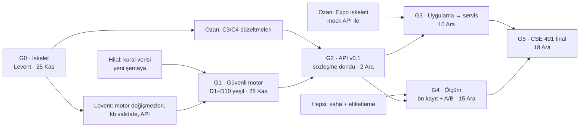

# 13 · İş planı ve görev dağılımı (baştan sona)

> **Durum:** KARAR · 21 Kasım 2026 (Levent, ürün sahibi; ekibe duyuruldu). Ö-06 (sahiplik), Ö-07 (GitHub Issues) ve
> Ö-10 (hafif CI) bu planla kabul edildi. Diğer Ö-önerileri hâlâ ÖNERİ durumundadır.
> Bu belge [11-yol-haritasi.md](11-yol-haritasi.md)'nin yerine geçmez; onu kişiye, dosyaya ve sıraya indirir.
> Her satır GitHub'da bir issue'dur: https://github.com/leventtcaan/nutriscan/issues

## 1. Üç kural: çakışma neden olmayacak

1. **Her dosyanın tek sahibi var** (§2). Bir dosyayı yalnız sahibi değiştirir. Başkasının dosyasında değişiklik
   gerekiyorsa issue açılır, sahibi yapar. `.github/CODEOWNERS` bunu PR'da zorlar: sahibin onayı olmadan merge olmaz.
2. **Ortak dosyalar sözleşmedir** (§2.4). `openapi.yaml`, alan tipleri (`types.py`), veri dosyası biçimleri ve
   `esikler.yaml` yalnız `sozlesme` etiketli bir PR'la değişir ve **üç kişinin de onayını** ister. Sözleşme önce
   değişir, kod sonra.
3. **Sıra kapılarla kilitli** (§3). Bir kapı açılmadan ona bağlı iş başlamaz. Kapılar birbirini beklemeyen iş
   hatlarını ayırır; herkes kapı beklerken kendi klasöründe çalışmaya devam eder.

## 2. Sahiplik haritası

### 2.1 Kim neyin sahibi

| Kişi | Alan | Dayanak |
|---|---|---|
| **Levent** | Platform (depo iskeleti, yapılandırma, CI, docker), bilgi tabanı yükleyici ve doğrulayıcı (`kb`), kural motoru (C6), analiz servisi ve API (C2), akış (`pipeline`), açıklama katmanı (C8), değerlendirme kodu (metrik, istatistik), uçtan uca entegrasyon, karar belgesi editörlüğü | §8 + TÜBİTAK İP1/İP3/İP4/İP5 |
| **Ozan** | Metin işleyici (C3), sözlük eşleyici (C4), anlamsal aday ve Qdrant (C5), model seçimi, sözlük verisi ve Türkçeleştirme, mobil uygulama ve OCR (C1) | §8 + TÜBİTAK İP1/İP3/İP5 |
| **Hilal** | Kural tablosu ve durum listesi verisi, kaynak ve lisans envanteri, kanıt bilgisi (C7: CTD/JECFA verisi ve arama), alerjen grupları, senaryo setleri, etiketleme kılavuzu, saha toplama koordinasyonu, proje web sitesi (CSE 492) | §8 + TÜBİTAK İP1/İP4/İP5 |
| **Hep birlikte** | Saha fotoğrafı ve metne aktarma, çift etiketleme, veri satırı incelemeleri, haftalık inceleme | TÜBİTAK İP2 |

### 2.2 Dosya → sahip (CODEOWNERS ile aynı)

| Yol | Sahip | İnceleyen |
|---|---|---|
| `service/pyproject.toml`, `service/nutriscan/config.py`, `kb/`, `rules/`, `api/`, `pipeline.py`, `explain/` | Levent | Ozan ya da Hilal (1 kişi) |
| `service/nutriscan/text.py`, `matching/` | Ozan | Levent |
| `service/nutriscan/evidence.py` | Hilal | Levent |
| `app/` | Ozan | Levent |
| `data/sozluk/` | Ozan | **2 kişi** (Levent + Hilal) |
| `data/kurallar/`, `data/kaynaklar.*`, `data/kanit/`, `data/sozluk/alerjen_gruplari.csv` | Hilal | **2 kişi** (Levent + Ozan) |
| `eval/kod/` (betikler) | Levent | Ozan |
| `eval/kilavuz.md`, `eval/senaryolar/`, `eval/saha.md` | Hilal | Levent + Ozan |
| `eval/data/` (etiketler) | Hepsi; her dosyanın başında yazarı | Diğer iki kişi |
| `tests/` | Test ettiği modülün sahibi | Modülün inceleyeni |
| `infra/`, `.github/` | Levent | Hilal |
| `docs/mimari-karar-belgesi.md`, `docs/tasarim/` | Levent (editör) | Değişen bölümün sahibi |
| `toplanti/` | O haftanın kayıt sorumlusu (dönüşümlü: Levent → Hilal → Ozan) | — |

### 2.3 İnceleme eşlemesi

Darboğaz olmasın diye herkesin "ilk inceleyeni" sabittir: Levent'in kodunu **Ozan**, Ozan'ın kodunu **Levent**,
Hilal'in verisini **Levent + Ozan** inceler. Veri satırı (kural, takma ad) her zaman iki kişi ister ve yazan kişi
inceleyen olamaz (K6). İnceleme süresi en geç 48 saat; geçerse haftalık senkronda ilk madde olur.

### 2.4 Sözleşme dosyaları (üç onay)

`docs/tasarim/openapi.yaml` · `service/nutriscan/types.py` · `docs/tasarim/04-veri-modeli.md` §3–§3.2 (dosya biçimleri)
· `data/config/esikler.yaml` · `docs/tasarim/schema.sql`. Bunlara dokunan PR `sozlesme` etiketini taşır.

## 3. Sıra: kapılar

- **G0 açılmadan** kimse `service/` içine kod yazmaz; çünkü G0 dosyaları yeni yerlerine taşıyor. Bu sırada Ozan
  `app/` içinde, Hilal `data/` içinde çalışır: farklı klasörler, çakışma yok.
- **G1 açılmadan** API birleştirilmez; yanlış güvence veren sonuç dışarıya açılmasın.
- **G2'de API sözleşmesi donar.** Uygulama o güne kadar `openapi.yaml`'dan üretilen sahte (mock) sunucuyla çalışır,
  G2'den sonra gerçek servise bağlanır.

## 4. CSE 491: kişi kişi işler (21 Kasım → 18 Aralık)

Kimlik biçimi: `<taş>-<kişi harfi><sıra>`. L = Levent, O = Ozan, H = Hilal, E = ekip. "Bağlı" sütunu: bitmeden
başlanamayan işler. Tarih: en geç.

### M0 · Güvenli temel (en geç 25 Kasım)

| ID | İş | Sahip | Bağlı | Kabul |
|---|---|---|---|---|
| M0-L1 | **G0 iskelet:** paket düzeni (davranış değişmeden taşıma), `pyproject.toml`, `config.py` + `esikler.yaml`, `types.py`, `codes.py`, CI, CODEOWNERS, PR/issue şablonları | Levent | — | Eski 12 test yeşil; CI çalışıyor |
| M0-L2 | Denetim A1–A4, A7, A11 için önce kırmızı regresyon testleri (motor) | Levent | M0-L1 | 6 test, bugünkü hatayı yakalıyor |
| M0-L3 | Motor değişmezleri D1–D10 + özellik testi | Levent | M0-L2 | M0-L2 testleri ve D-testleri yeşil |
| M0-O1 | Denetim A5, A6, A8, A9, A10 için önce kırmızı testler + C3/C4 düzeltmeleri (NFC, ASCII başlık, yapılandırılmış beyan, "içerebilir" kapsamı, E-kodu bulanık yasağı, `ambiguous`) | Ozan | M0-L1 | 5 test yeşil; kelime listeleri `dil_kaliplari.yaml`'da |
| M0-O2 | Expo iskeleti: `app/` kurulumu, gezinme, i18n dosyası, `openapi.yaml`'dan tipler, mock sunucu | Ozan | — | Uygulama simülatörde açılıyor, mock'tan durum listesi geliyor |
| M0-H1 | `kurallar_v0.csv` → `kurallar.csv` yeni şemaya (04 §6 eşlemesi), 17 satır `taslak`; `durumlar.csv`, `turetilen_alanlar.csv` | Hilal | — | `kb validate` (M1-L1) çıkınca geçecek biçimde |
| M0-H2 | `kaynaklar.csv`: OFF ürün kayıtları, `additives_classes`, WHO/KDIGO/EFSA/ADA/1333 satırları; OFF lisans sorusu taslağı (Levent onayıyla gider) | Hilal | — | Envanter eksiksiz |
| M0-H3 | LAK-01 hedef genişletme, LAK-03 ve SUL-03 (`icerebilir`), SUL-01'e `en:sulfite`; taslak olarak | Hilal | M0-H1 | 2 inceleyici atanmış PR |
| M0-E1 | Ö-01…Ö-13 senkron oylaması; kabul edilenler karar belgesi v1.4'e | Levent (editör), hepsi | — | v1.4 commit'i |

### M1 · Servis iskeleti (en geç 2 Aralık; MR5 27 Kasım'da G0 + G1 gösterilir)

| ID | İş | Sahip | Bağlı | Kabul |
|---|---|---|---|---|
| M1-L1 | `kb validate` (04 §4'teki 10 kural) + `kb build` (PostgreSQL) | Levent | M0-L1, M0-H1 | Bilerek bozulan örnek dosyaların hepsi yakalanıyor |
| M1-L2 | FastAPI: `/v1/analyses`, `/v1/conditions`, `/v1/version`, `/healthz`; sözleşme testi; log filtresi | Levent | M0-L3 (G1) | Yanıtlar `openapi.yaml`'a uyuyor |
| M1-L3 | `infra/docker-compose.yml` (servis + PostgreSQL + Qdrant), `make up / kb / check` | Levent | M1-L1 | Temiz makinede tek komutla ayağa kalkıyor |
| M1-O1 | Sabitlerin dışarı alınması (C3/C4): eşik `esikler.yaml`, çoğul istisnaları, belirsiz takma ad raporu | Ozan | M0-O1 | `rg` taramasında C3/C4'te sabit yok |
| M1-O2 | Uygulama: profil ekranı (`GET /v1/conditions`), metin + besin girişi, sonuç listesi (mock) | Ozan | M0-O2 | Her ekranda 4 durumun ekran görüntüsü |
| M1-H1 | `eval/saha.md`: mağaza izin metni, fotoğraf ve metne aktarma yönergesi, ilk 2 satış noktası (Ö-13) | Hilal | — | Yönerge birleşmiş; izinli noktalar listesi |
| M1-H2 | Etiketleme kılavuzu v1 (`eval/kilavuz.md`) | Hilal | — | Levent + Ozan onayı |
| M1-E1 | **MR5 (27 Kasım):** form + demo (G0, G1, iskelet) | Levent (bu haftanın kayıt sorumlusu) | — | `toplanti/2026-11-27-…` |

### M2 · Veri ve anlamsal arama (en geç 9 Aralık)

| ID | İş | Sahip | Bağlı | Kabul |
|---|---|---|---|---|
| M2-E1 | Saha toplama: en az 5 satış noktası (her üye en az 1), fotoğraf depoya girmez, metin girer | Hepsi (koordinasyon Hilal) | M1-H1 | `eval/data/saha_*.jsonl` |
| M2-E2 | 100 ifade çift etiket (her ifade iki farklı üye) + kappa | Hepsi | M1-H2, M2-E1 | `eval/data/ifadeler.jsonl`, kappa raporu |
| M2-O1 | Qdrant koleksiyonu + C5 + kabul kuralı (05 §4) | Ozan | M1-L3, M1-O1 | Mock testleri + 1 entegrasyon testi |
| M2-O2 | Model ve τ/δ seçimi **yalnız geliştirme kümesinde**; `esikler.yaml` donar (`sozlesme` PR) | Ozan | M2-O1, M2-E2 | `fixed_on` ve dev karması commit'te |
| M2-O3 | OCR denemesi: 20 etiket, karar kaydı (`docs/arastirma/ocr-deneme.md`) | Ozan | M0-O2 | Karar kaydı birleşmiş |
| M2-H1 | 20 senaryo (A1–A11 kenar durumları dahil), beklenen sonuç kaynaklı, sistem çalıştırılmadan | Hilal | M0-H1 | `eval/senaryolar/` 20 dosya, 1 kontrolcü |
| M2-H2 | Senaryoların ihtiyaç duyduğu kural satırlarının incelemesi ve `etkin` yapılması | Hilal + 2 inceleyici | M2-H1, M1-L1 | Bu satırlar `etkin`, `kb validate` yeşil |
| M2-L1 | Değerlendirme kodu: metrikler, Wilson, kesin McNemar, ayrım ve karma kilidi (09) | Levent | M1-L1 | Sentetik veriyle birim testleri |
| M2-L2 | Açıklama katmanı: şablon açıklayıcı + denetim kuralları (08) | Levent | M1-L2 | Denetim testleri; LLM'siz akış tam |

### M3 · Ölçüm ve bütünleşme (en geç 15 Aralık)

| ID | İş | Sahip | Bağlı | Kabul |
|---|---|---|---|---|
| M3-L1 | Ön kayıt (`eval/onkayit.md`), sonra eşleme sınavı A ve B | Levent | M2-O2, M2-E2, M2-L1 | Rapor: metrikler + aralıklar + McNemar + sürümler |
| M3-L2 | Kural sınavı 20 senaryo | Levent + Hilal | M2-H2 | Kaçırılan/gereksiz uyarı, Doğrulanamadı oranları |
| M3-O1 | Uygulama ↔ gerçek servis (G3); sonuç kartı ve "Neden?" ekranı | Ozan | M1-L2, M1-O2 | Demo senaryosu telefonda baştan sona |
| M3-O2 | OCR (deneme kararı olumluysa) | Ozan | M2-O3 | Değilse metin elle girilir (karar belgesi §9) |
| M3-H1 | Kanıt bilgisi (C7): seçili maddeler için CTD/JECFA kayıtları + arama | Hilal | M1-L1 | Yanıtta `evidence`, sonucu etkilemiyor (test) |
| M3-L3 | LLM açıklayıcı (Ö-08 kararıyla, gizlilik koşulu sağlanırsa) | Levent | M2-L2 | Denetimden geçme oranı raporlu |

### M4 · CSE 491 teslimi (en geç ~18 Aralık)

| ID | İş | Sahip | Bağlı |
|---|---|---|---|
| M4-E1 | Hata düzeltme haftası (yalnız hata, yeni özellik yok) | Herkes kendi alanında | M3 |
| M4-L1 | Final raporu (ara raporun şablonu + ölçüm sonuçları) | Levent (editör); bölümler sahiplerinden | M3-L1, M3-L2 |
| M4-E2 | Demo provası ve demo senaryosu dondurma | Hepsi | M3-O1 |

## 5. CSE 492 ve TÜBİTAK (Şubat → Haziran 2027)

Tarihler teyit edilmedi; bahar takvimi açıklanınca güncellenir. TÜBİTAK desteği gelirse İP1–İP5 bu taşlarla çakışır;
gelmezse aynı plan dönem içi hedef olarak sürer.

| Taş | İçerik | Sahipler |
|---|---|---|
| S1 · Şubat | Protokolün kesinleşmesi (H2 sınırı Δ, durum listesi, ön kayıt); kural incelemesinin bütün durumlara yayılması | Levent (protokol), Hilal (kurallar) |
| S2 · Mart | ≥ 400 ifade çift etiket, kappa (TÜBİTAK İP2); ≥ 280 saha ifadesi test kümesinde | Hepsi |
| S3 · Nisan | Tam A/B deneyi, en az bir alternatif modelle karşılaştırma, hata analizi (İP3) | Ozan (model, arama), Levent (deney, analiz) |
| S4 · Mayıs | ≥ 40 senaryo kural sınavı (İP4), OCR bütünleşik akış, uygulama cilası | Hilal (senaryolar), Levent (motor), Ozan (uygulama) |
| S5 · Haziran | Bütünleşik değerlendirme (İP5), poster, proje web sitesi, demo videosu, final raporu (jüriden 10 gün önce), kongre bildirisi taslağı | Hepsi; web sitesi Hilal, video Ozan, rapor ve bildiri Levent (editör) |

## 6. Günlük çalışma (herkes, her iş)

1. Issue'yu üzerine al (assign), dalı aç: `<isim>/<issue-no>-<kisa-konu>` (ör. `ozan/12-c3-beyan`).
2. Gün başında `git pull --rebase origin main`. Dal en fazla 3 gün yaşar; büyürse böl.
3. Yalnız sahibi olduğun dosyalara dokun. Başka birinin dosyasında ihtiyaç varsa issue aç ve ona ata.
4. PR açarken şablonu doldur, `Closes #n` yaz; CI yeşil olmadan inceleme isteme.
5. İnceleme 48 saat içinde. Sahibi merge eder (squash). Merge sonrası dal silinir.
6. Agent'larla çalışırken (Claude Code, Codex, Antigravity): agent'a issue numarasını ve ilgili tasarım bölümünü
   ver; agent AGENTS.md'yi okur. Agent veri satırını etkinleştiremez, eşik ya da ayrım dosyasını değiştiremez.
7. Kural ve takma ad satırları (iki kişilik inceleme isteyen veri) kodla aynı PR'a girmez; inceleme ayrı yapılır.
8. Etiket ve saha dosyaları kişi başınadır (`eval/data/saha_<isim>_<tarih>.jsonl`, `etiket_<isim>.jsonl`); iki kişi aynı
   dosyaya yazmaz, birleştirme betikle yapılır.

## 7. Plan kimliği → GitHub issue

Milestone'lar: M0–M4 (CSE 491) ve S1–S5 (CSE 492). Her issue'da bağlı olduğu işler numarasıyla yazılıdır.

- **M0:** M0-L1 [#7](https://github.com/leventtcaan/nutriscan/issues/7) · M0-L2 [#8](https://github.com/leventtcaan/nutriscan/issues/8) · M0-L3 [#9](https://github.com/leventtcaan/nutriscan/issues/9) · M0-O1 [#10](https://github.com/leventtcaan/nutriscan/issues/10) · M0-O2 [#11](https://github.com/leventtcaan/nutriscan/issues/11) · M0-H1 [#12](https://github.com/leventtcaan/nutriscan/issues/12) · M0-H2 [#13](https://github.com/leventtcaan/nutriscan/issues/13) · M0-H3 [#14](https://github.com/leventtcaan/nutriscan/issues/14) · M0-E1 [#15](https://github.com/leventtcaan/nutriscan/issues/15)
- **M1:** M1-L1 [#16](https://github.com/leventtcaan/nutriscan/issues/16) · M1-L2 [#17](https://github.com/leventtcaan/nutriscan/issues/17) · M1-L3 [#18](https://github.com/leventtcaan/nutriscan/issues/18) · M1-O1 [#19](https://github.com/leventtcaan/nutriscan/issues/19) · M1-O2 [#20](https://github.com/leventtcaan/nutriscan/issues/20) · M1-H1 [#21](https://github.com/leventtcaan/nutriscan/issues/21) · M1-H2 [#22](https://github.com/leventtcaan/nutriscan/issues/22) · M1-E1 [#23](https://github.com/leventtcaan/nutriscan/issues/23)
- **M2:** M2-E1 [#24](https://github.com/leventtcaan/nutriscan/issues/24) · M2-E2 [#25](https://github.com/leventtcaan/nutriscan/issues/25) · M2-O1 [#26](https://github.com/leventtcaan/nutriscan/issues/26) · M2-O2 [#27](https://github.com/leventtcaan/nutriscan/issues/27) · M2-O3 [#28](https://github.com/leventtcaan/nutriscan/issues/28) · M2-H1 [#29](https://github.com/leventtcaan/nutriscan/issues/29) · M2-H2 [#30](https://github.com/leventtcaan/nutriscan/issues/30) · M2-L1 [#31](https://github.com/leventtcaan/nutriscan/issues/31) · M2-L2 [#32](https://github.com/leventtcaan/nutriscan/issues/32)
- **M3:** M3-L1 [#33](https://github.com/leventtcaan/nutriscan/issues/33) · M3-L2 [#34](https://github.com/leventtcaan/nutriscan/issues/34) · M3-O1 [#35](https://github.com/leventtcaan/nutriscan/issues/35) · M3-O2 [#36](https://github.com/leventtcaan/nutriscan/issues/36) · M3-H1 [#37](https://github.com/leventtcaan/nutriscan/issues/37) · M3-L3 [#38](https://github.com/leventtcaan/nutriscan/issues/38)
- **M4:** M4-E1 [#39](https://github.com/leventtcaan/nutriscan/issues/39) · M4-L1 [#40](https://github.com/leventtcaan/nutriscan/issues/40) · M4-E2 [#41](https://github.com/leventtcaan/nutriscan/issues/41)
- **S1:** S1 [#42](https://github.com/leventtcaan/nutriscan/issues/42)
- **S2:** S2 [#43](https://github.com/leventtcaan/nutriscan/issues/43)
- **S3:** S3 [#44](https://github.com/leventtcaan/nutriscan/issues/44)
- **S4:** S4 [#45](https://github.com/leventtcaan/nutriscan/issues/45)
- **S5:** S5 [#46](https://github.com/leventtcaan/nutriscan/issues/46)
