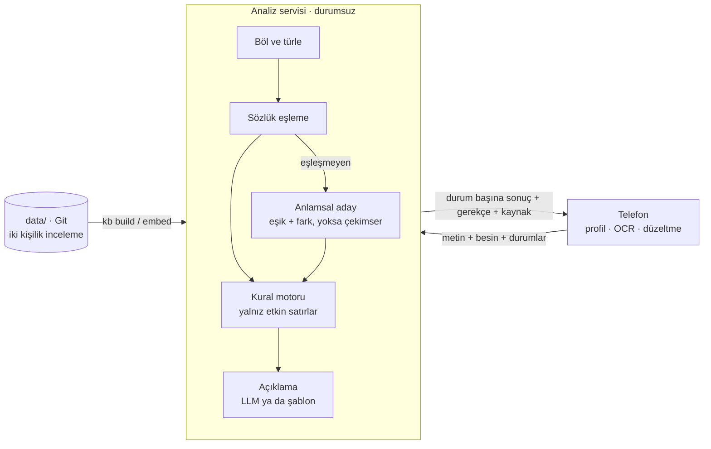

# NutriScan uygulama tasarım paketi

> **Durum:** ÖNERİ · 18 Kasım 2026 · ekip incelemesi ve Çarşamba senkronunda oylama bekliyor.
> **Kural:** karar belgesi ([docs/mimari-karar-belgesi.md](../mimari-karar-belgesi.md)) *ne* yapılacağını, bu paket
> *nasıl* yapılacağını söyler. İkisi çelişirse karar belgesi kazanır; değişiklik önerileri
> [12-karar-onerileri.md](12-karar-onerileri.md)'de bekler.

## Okuma sırası

| # | Belge | Cevapladığı soru | Kimin için önce |
|---|---|---|---|
| 00 | [Denetim raporu](00-denetim-raporu.md) | Şimdiye kadar ne yanlış, ne sabitlenmiş, sapmayı ne önler? | Herkes |
| 01 | [Kapsam ve gereksinimler](01-kapsam-ve-gereksinimler.md) | Ne yapıyoruz, ne yapmıyoruz; FR/NFR ve kabul ölçütleri | Herkes |
| 02 | [Mimari (C4)](02-mimari.md) | Parçalar neler, nasıl konuşur, nerede çalışır? | Levent, Ozan |
| 03 | [API sözleşmesi](03-api-sozlesmesi.md) + [openapi.yaml](openapi.yaml) | Uygulama servisle hangi biçimde konuşur? | Ozan, Levent |
| 04 | [Veri modeli](04-veri-modeli.md) + [schema.sql](schema.sql) | Bilgi tabanı nerede yazılır, nasıl onaylanır, nasıl okunur? | Hilal, Levent |
| 05 | [Eşleme hattı](05-esleme-hatti.md) | Etiket ifadesi kavrama nasıl bağlanır; anlamsal aday ne zaman kabul edilir? | Ozan |
| 06 | [Kural motoru](06-kural-motoru.md) | Sonuç nasıl hesaplanır; hangi değişmezler asla bozulmaz? | Levent, Hilal |
| 07 | [Mobil uygulama](07-mobil-uygulama.md) | Ekranlar, durumlar, OCR denemesi | Ozan |
| 08 | [Açıklama katmanı](08-aciklama-katmani.md) | LLM ne yapar, ne yapamaz; denetim kuralları | Levent |
| 09 | [Değerlendirme protokolü](09-degerlendirme-protokolu.md) | H1/H2 nasıl sınanır; veri kümesi, etiketleme, metrikler | Herkes |
| 10 | [Çalışma düzeni](10-calisma-duzeni.md) | Issue → dal → PR → CI → inceleme; DoR/DoD; agent kuralları | Herkes |
| 11 | [Yol haritası](11-yol-haritasi.md) | M0–M4 kilometre taşları, sahipler, en geç tarihler | Herkes |
| 12 | [Karar önerileri](12-karar-onerileri.md) | Karar belgesinde neyin değişmesi öneriliyor? | Toplantı gündemi |

## Tek sayfada sistem

## Bu paketin uymak zorunda olduğu beş kural

1. Sağlık sonucunu yalnız iki kişilik incelemeden geçmiş kural satırları belirler (K5, K6).
2. Belirsizlik riski yalnız artırır: boş, tanınmayan ya da eksik veri asla "Engel bulunmadı" vermez (kırmızı çizgi 3).
3. Ürün, etiket metni ve sağlık profili sunucuda saklanmaz, loglanmaz (K1).
4. Ölçülen sistem ile ürün aynı koddur; eşikler yalnız geliştirme kümesinde sabitlenir (NFR-8).
5. Kodda sabit yok: eşik, durum, kelime listesi ve yol yapılandırmadan gelir (NFR-9).
